# LOAF BREAKER

LOAF BREAKER is a hardcore firmware for the M-VAVE FM-1, built by FLEXOR on **CHOPPAH**, Laurens Profittlich's Amen
chopper. A break is cut into sixteen slices, one on each white key, and plays in time while you rearrange it, roll
it, reverse it, stop it like a tape and push it through effects; under it a kick made for terror, gabber and
crossbreed (DISTO, its own synth, its own effects, notes on every step), a sequencer of 16, 32 or 64 steps, tracks
with built-up drops, a snare, a hat and a clap, a compressor and a CDJ-style waveform of what leaves the mix. Kicks and
drums, nothing else: the melody (0.198–0.208) is gone since 0.209.

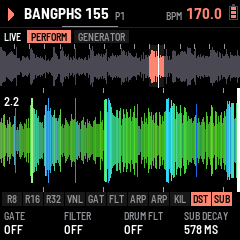

---

## Start in five minutes

LOAF BREAKER turns the M-VAVE FM-1 into a hardcore break machine: a breakbeat cut into 16 slices, a distorted kick
built from scratch, drums, effects and drops. You don't need the whole manual to start: these five steps are enough.
The FM-1 starts in **BEGINNER** mode (SYSTEM › SETUP: GLO, then SELECT; K3): the advanced pages stay hidden until you want them.

**Or let the FM-1 show you: the TUTORIAL.** A new FM-1 asks first, after its start screen: **TUTORIAL**, **BEGINNER**
or **EXPERT** (a knob moves the choice, PLAY takes it; white keys 1–3 too). SYSTEM › SETUP K3, turned left past
BEGINNER, starts the tutorial again. The header says one thing to do at a time, the button or the keys that do it blink, and
when it's done, "OK!" and the next: at once for a button (HOME, EDIT, SEQ, SAVE ..), five seconds later where there is
something to hear (an effect, a kick, the drop): 30 steps in nine lessons, THE
BREAK (HOME: the PERFORM menu, PLAY, the slices, ALGORITHM: another break), HOME (0.9.2: HOME again, GENERATOR; HOME again,
PERFORM; HOME held, the slices; HOME held again, the waveform), EFFECTS (a black key; ARP, its page, two of its effects), THE PATTERN (SEQ: two kicks, a snare),
THE KICK (EDIT, PLAY to stop: stopped, white keys 1–4 play the kick, the snare, the hat and the clap; KNOB 1 a built-in
kick, key 1 to hear it; KNOB 2 its DISTO; EDIT again: SHAPE, KNOB 3 a longer tail; PRESETS: your twenty kicks, each heard
on key 1), THE DRUMS (SELECT: the SNARE, KNOB 1 its presets, KNOB 2 its FX, heard on key 2), THE FX (PLAY again, FX,
PRESETS: an effect), THE DROP (SEL + ENV) and SAVE. Everything is real: you play the firmware itself. The page buttons a step doesn't ask for do nothing meanwhile ("FOLLOW THE STEP"; GLO still quits); off the step's page all the same, the header says how to get back there ("PRESS HOME: BACK TO THE BREAK"), that button blinking. **SEL + GLO** skips a step, **GLO** quits (SETUP K3 starts it
again where you left it; SAVE keeps where you are). An FM-1 already in use when it updates doesn't start it. AUTO SAVE (SYSTEM › SETUP K4) is off while the tutorial runs and comes on when it ends (or you quit it); choosing BEGINNER at the first start turns it on too.

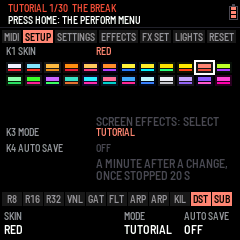

### 1. Press PLAY

The break plays with its kick at once (the slowest to start, AMEN10 135; the breaks go slowest to fastest; once saved, the FM-1 starts on the break you left it on). **ALGORITHM** picks the next break (it changes on the next
bar), **SELECT** sets the tempo, **PRESETS** the pattern (P1–P64). PLAY again stops.

### 2. Play the white keys: the slices

The 16 white keys are the break's 16 slices. Tap one: that slice. **Hold one: it loops** until you let go, in time.
Play two or three in turn and you are already chopping.

### 3. Hold a black key: the effects

The black keys act while held and can be combined. A new FM-1 has CHOPPAH's, left to right: **R8 · R16 · R32** roll
the break, **REV** plays it backwards, **FRZ** freezes the slice playing, **HLF** halves the speed, **VNL** stops it like
a record, **GAT** gates it, **RND** shuffles the slices, **FLT** sweeps a filter, **DUB** throws it into an echo. While
one is held, K1–K4 tune it. In EXPERT, **ARP › BLACK** gives them another layout (FLEXOR LAYOUT: two ARP keys, the
kicks' TRI, X4 and X2, SUB, DST, KIL) or your own.

### 4. EDIT: shape the kick

**EDIT** opens the kick, drawn large: what you hear, its pitch falling in amber. K1–K4 change the part shown;
**ALGORITHM** goes to the next part, **SELECT** to the next section (ATTACK, BODY, TAIL, DIRT, FX1, FX2, MORE: the tabs at the top), and **EDIT** again to the next sound (KICK, SNARE, HAT, CLAP, round). In EXPERT it opens on ATTACK's **PRESET**: KNOB 1 picks a built-in kick, 909 to SPINE. Each part
says in a few words what it is for. Try **DIRT › DISTO** (K1: the distortion) and **TAIL › BASS** (K2: the
rawstyle reverse bass). **PRESETS** there picks one of the 20 kick memories: each keeps its own sound.

### 5. Build and drop

**SEL + ENV**: a build from the next bar, then the drop. Then write your own patterns on **SEQ** (white keys: the
steps of the lane shown; ALGORITHM: the lane, SELECT: the view FULL, DRUMS, GROOVE) and chain them on **ENV** (TRACKS: patterns and drops one after another).

### Two buttons to remember

- **SEL**, tapped alone: the card of shortcuts, those that work everywhere and those of the page you are on.
  Twice quickly: SEL stays held (lit) for one-handed shortcuts; once more frees it.
- **SAVE**: keeps everything (or SYSTEM › SETUP: AUTO SAVE).

### Moving around (0.9.2)

On every page with tabs, **SELECT turns the tabs at the top** (EFFECTS' slots, SONG's TRACKS PLAY DROP BUILD BUILD BRK DROP BANK, MIX's
LEVELS ROUTING MASTER DYNAMICS, SYSTEM's parts, ARP's tabs, the KICK menu's sections) and **ALGORITHM those below**
(an effect's MAIN MORE MOD, the kick's parts). **A page's button pressed again goes back to HOME**, the main page
(FX, ENV, LFO, GLO, ARP; EDIT keeps going round the sounds). The tempo is SELECT's on HOME.

### Playing live: SEL + K1–K4

**Hold SEL and turn K1–K4, on any page: the kick changes while it plays.** That is the FM-1's live shortcut, the one
to remember above all in EXPERT. Out of the box: **SEL + K1** DRIVE, **SEL + K2** SCREAM, **SEL + K3** SCREECH, **SEL +
K4** DISTO; their names and values show at the foot of the screen while SEL is held. Each kick (KICK 1–20) keeps its own
four, chosen in **EDIT › KNOBS** (the four knobs one by one, or a whole style at once on **ASSIGN**).

**SEL twice quickly locks it down: SEL blinks** and counts as held, so both hands are free: K1–K4 move the kick, and
every SEL combination works with one hand. **SEL once more frees it** (the light goes out). Lock it before a set: the
four kick knobs are always under your fingers, whatever page is open.

When you know your way around: **SYSTEM › SETUP (GLO, then SELECT), K3 → EXPERT** shows every page (the kick's layers and their effects,
SCREAM and DISTO +, SYNTH +, CLEAN MORPH, each knob's settings…). The rest of this manual covers everything.

---

## Contents

1. Install
2. The screens
3. Playing
4. The pads
5. Patterns and the sequencer
6. The FX chain
7. SYSTEM (GLO): MIDI, setup, screen effects, reset
8. The drums: kick, snare, hat
9. The mixer
10. Pages and knobs
11. The control map
12. Saving
13. Troubleshooting

---

## 1. Install

**Try it first:** the emulator runs the same code in the browser, with sound, played with the mouse.

**Install:** open the install page in Chrome or Edge, connect the FM-1 by USB and press Install. While it writes,
the FM-1 shows LOAF BREAKER's picture, UPDATING and DO NOT UNPLUG, and the bar fills. When it is done, the page
throws confetti. If the FM-1 runs M-VAVE's FM1 Open firmware, put M-VAVE's original firmware back first (M-VAVE's workbench, *Restore original*), then
install LOAF BREAKER.

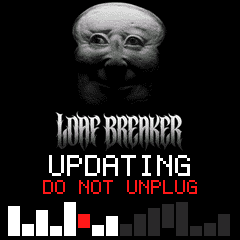

## 2. The screens

At power-on LOAF BREAKER shows its picture, then the start screen: the loaded break drops in slice by slice while a light
runs through the buttons, they all flash as it completes, and PLAY blinks green. After two
seconds, or at once on any key, the **slicer view** opens. PLAY on the start screen also starts the break.

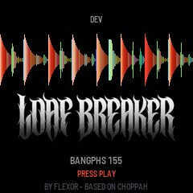

The slicer view, top to bottom:

- **Header:** play or stop, the break's name, the pattern (P1–P64; "P2>" while P2 waits for the loop's end), REC
  while recording, a level meter (left and right, what leaves after MASTER: amber from
  −8 dB, white near full scale), the tempo: lit white on each beat. The line under the header flashes on each kick
  and a tick under it walks the bar's four beats. The PLAY light blinks off on each kick, and during a build the
  next white key to light blinks, faster as the drop nears.
- **Tabs:** the page's domain (on SOUNDS, the source: KICK, DRUMS, BREAK), then its parts as tabs, the one
  you are on lit: the button again (or ALGORITHM) goes to the next. On SOUNDS and EFFECTS the part edited shows at the
  right, "< SUB FX >". Opening a page, or turning to another part, says the same in the header for a moment: the
  domain, then the part ("SYSTEM SETUP", "SOUNDS KICK DIRT DISTO", "EFFECTS SLOT 2 TREMOLO", "PATTERN H1"). The tabs sit right under the header on every
  page, tap tempo's too.
- **The break:** its waveform, the slice markers, the slice sounding lit, the playhead.
- **Slice blocks:** sixteen blocks, one per white key, each with its slice's waveform. The slice sounding is lit;
  a key held is outlined; a dot marks a key with a loop of its own (§3, key loops).
- **Pads:** the eleven black-key pads, lit while held.
- **Knobs:** the page's four knobs and their values; where the page knows how far a knob is turned (an FX slot, the
  MIXER's levels, the kick's classic view), an arc beside the value shows it.

### How it is organised (0.201)

Each button is a **domain**, named on the screen (the button keeps its print), in the order the sound travels:
sources, the pattern, the song, the mix, the effects, the system.

| Button | Domain | Its parts |
| --- | --- | --- |
| HOME | LIVE | PERFORM, GENERATOR, SPLIT (EXPERT, 0.9.71), CHAOS (0.9.75); HOME again: the next tab (its settings are SYSTEM › DISPLAY's since 0.9.56). HOME is the main page: FX, ENV, LFO, GLO or ARP pressed again come back to it, SELECT turning their tabs |
| EDIT | SOUNDS | Three sources, **SEL + EDIT** the next: **KICK** (its menu, by the kick's anatomy: ATTACK, BODY, TAIL, DIRT, FX1, FX2, MORE; SELECT its next section; EDIT again the next sound, EXPERT: SNARE, HAT, CLAP, then the KICK), **DRUMS** (SNARE, HAT, CLAP; EDIT again the next), **BREAK** (PITCH, GRAIN, SNAP, LEVEL; ALGORITHM the break) |
| SEQ | PATTERN | The lanes (ALGORITHM); the views FULL, DRUMS and **GROOVE** (SWING, BREAK ROWS, FOLLOW; also SEL + ARP) on SELECT |
| ENV | SONG | TRACKS, PLAY, DROP, BUILD, BUILD BRK, DROP BANK |
| LFO | MIX | LEVELS (BREAK, KICK, PERC), ROUTING (FX, the drums' route, DUCKS, ROLL), MASTER, DYNAMICS |
| FX | EFFECTS | The four slots: MAIN, MORE, MOD |
| GLO | SYSTEM | MIDI (EXPERT: K3 METER), SETUP (K1 SKIN, K2 KICK EQ (EXPERT), K3 MODE, K4 AUTO SAVE; PRESETS the skin, as K1), DISPLAY (K1 VIEW, K2 WAVE TYPE, K3 WAVE ZOOM, K4 BREAK TIME; HOME's until 0.9.55), SCREEN FX (the screen's effects; K3 DRUM FILTER, K4 KICK SWITCH), SCREEN SET (their settings), LIGHTS (K1 GLOW, K2 PULSE, K3 PULSE ON, K4 STYLE; 0.9.57), RESET |

The same gestures everywhere: **the button again** is the next part; **ALGORITHM** the element in the part (a slot, a
lane, a drum's part; where there is nothing to pick, the break); **PRESETS** the pattern, but on SOUNDS the source's
memory (KICK 1–20, a drum's sound); **SEL + a button** that domain's second function, one
table (tap SEL alone to see it):

| SEL + | Does | SEL + | Does |
| --- | --- | --- | --- |
| EDIT | The next source | REC | Clear (the lane on SEQ, the pattern elsewhere) |
| SEQ | Copy the pattern; on another, paste | SAVE | Undo |
| ENV | The build, then the drop | ALGORITHM | The break |
| ARP | PATTERN's GROOVE | SELECT | The drums' filter |

(0.200 had the earlier layout: its release stays on GitHub, to go back to it.)

**The rules.** ALGORITHM picks what you edit on the page (an FX slot, a drum's part, a SEQ lane, SYSTEM's part); on HOME (both its parts) and the MIXER, where there is nothing to pick, it is the break. PRESETS picks what goes
in (an effect, a kick, a snare or hat sound); elsewhere it is the pattern. **SEQ is where everything is sequenced**
(the break's steps and the kick, snare and hat lanes), **EDIT where the drums' sounds are made** (kick, snare, hat);
the white keys play slices everywhere but SEQ and ENV (tracks). **ARP opens its page of effects** (§5). **SEL + ALGORITHM is the break and SEL +
PRESETS the pattern on every page.** **Where ALGORITHM alone is already the break** (HOME, SOUNDS › BREAK, SONG's PLAY / DROP / BUILD, MIX, ARP's tabs but ARP), **SEL + ALGORITHM is BREAK TIME** (right HALF, left NORMAL), **and SEL + PRESETS the kick** on HOME, PATTERN, MIX, ARP and SYSTEM's MIDI, SCREEN SET, RESET (0.9.26, FLEXOR). A page's button pressed again is its next part. **Press SEL** alone and the strip
shows a card: above, the four SEL combinations that work on any page; below, this page's own shortcuts (on HOME and
the pages without any: what SEL + K1–K4 turn). SEL again, or any other button, key or knob, closes it. The control map (§11) shows all of it at once.

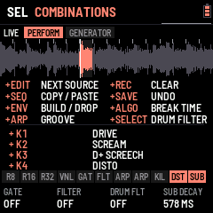

## 3. Playing

| Control | Does |
| --- | --- |
| PLAY | Play / stop. HOME + PLAY: back to bar 1 |
| White keys | Slices 1–16. Playing: at the next snap point (SOUNDS › BREAK, SNAP: 1 slice, an 8th on the 2-bar breaks, by default; OFF, 1/8 … 4 slices). Stopped: at once. Held: the key loops (below), playing or stopped |
| SELECT | Tempo, 1 BPM a detent · **SEL + SELECT**, on any page: the drums' filter (DRUM FLT, as HOME's K3) |
| ENV | **TRACK**: tracks of patterns and drops, playing them, the drop's settings (below) |
| SEL (pressed alone) | The combinations card: every SEL combination on the strip. SEL used with something else (SEL + a knob, SEL + ALGORITHM, SEL + REC…) does that instead |
| SEL + ALGORITHM | The break, from any page; **BREAK TIME** (right HALF, left NORMAL) where ALGORITHM alone is already the break: HOME, SOUNDS › BREAK, SONG's PLAY / DROP / BUILD, MIX, ARP's tabs but ARP (0.9.26) |
| SEL + PRESETS | The pattern, from any page; **the kick** (KICK 1–20) on HOME, PATTERN (SEQ, GROOVE), MIX, ARP and SYSTEM's MIDI, SCREEN SET, RESET; in the KICK menu the kick on KNOBS, ASSIGN, K1–K4 SET (PRESETS alone their knob presets, 0.9.66) and on FX1, FX2 |
| SEL + ARP | PATTERN › GROOVE; **in the KICK menu: copy the kick, then, on another kick (PRESETS), paste it** (its sound, LAB, KNOBS and FX; its volume kept); on a drum's page the same for that drum's memories (0.9.26) |
| SEL + SAVE | **Undo** the last pattern wipe (SEL + REC, a drum lane's FILL, CLR / 4X4 or COPY); again: redo |
| OCT− / OCT+ | Pitch in semitones (hold to go faster). Both: back to 0. Back to 0 at every start too (0.9.73) |
| PRESETS | The pattern, P1–P64 (§5); while playing the new one starts at the end of the loop |
| SEQ · REC | The sequencer; recording the keys into the pattern (§5). SEL + REC: clear the pattern (SEL + SAVE takes it back) |
| MIDI notes | Notes 48–63 (C3–D#4) play slices 1–16, held like the white keys; 36 the kick, 38 the snare, 39 the clap, 42 / 44 / 46 the hat (§8); any channel. SYSTEM › MIDI's PRESETS, NOTES IN: ALL, DRUMS (the drums alone), OFF |
| ALGORITHM | (HOME, MIXER; SEL held: any page) The next or previous break: its name shows at once (amber in the header) and, while playing, it comes in at the next bar (the old one goes quiet for the bar's last 16th meanwhile); stopped, at once. AMEN10 135, AMEN05 158, AMEN20 164, UPDOWN 165, AMEN06 169, AMEN19 172, AMEN13 173 (the Amens: The Winstons, cut by Cyberworm), FOCUZ 175 (DNGN DRGNS, "Focuz (DNGN DRGNS Remix)"): 2 bars each, slowest first, played at the tempo you set; then **your own breaks**, if you sent some (below) |
| MASTER | Volume |

### The app (Android)
The site is also an **app** (0.9.71, FLEXOR): on an Android phone, open it in **Chrome**, then Chrome's menu,
**Install app** (or Add to Home screen). It opens full screen on **App**: **Live**, **Studio**, **Breaks**, **Import**,
**Update** (0.9.74: the installer, to put the newest LOAF BREAKER on the FM-1 from the phone; keep the screen on and
the app in front until it says done) and the manual. Plug the FM-1 into the phone with a **USB-C cable** (an OTG one if the phone asks; LOAF BREAKER has no
Bluetooth), press **Connect** and allow MIDI.

**Live** is the FM-1 in your hand: its screen, live, and its whole panel under your fingers, as the FM-1's own: the
buttons (PLAY, REC, SEL, SAVE, HOME, EDIT, SEQ, ENV, LFO, FX, ARP, GLO, OCT), the seven knobs (drag up or down on one,
or tap its − and +), the 11 black keys and the 16 white keys (hold as long as you hold your finger, several at once),
MASTER, and **Drop** (SEL + ENV in one press). The lit buttons and keys light on the phone too. It keeps the phone
awake while it is connected. It works the same from a computer (Chrome or Edge).

### The split
**HOME › SPLIT** (0.9.71, FLEXOR, from CHOPPAH 1.5; EXPERT: HOME, HOME again, HOME again) puts **two
breaks in one loop**: bar 1 is a bar of break A (the break playing), bar 2 a bar of break B, repitched to A's bar so the
two stay in time whatever their own tempos (as an old sampler would).

| Knob | Sets |
| --- | --- |
| K1 SPLIT | OFF · ON: the break becomes the two at the next bar (stopped, at once); the header shows both, "AMEN10+FOCUZ" |
| K2 BREAK B | Any break, the firmware's and yours (at first the one after A) |
| K3 BAR A | Which of A's two bars plays: BAR 1 · BAR 2 |
| K4 BAR B | Which of B's two bars plays: BAR 1 · BAR 2 |

Playing a split: white keys **1–8 are A's slices, 9–16 B's**. A key plays its slice as on any break, and the loop
always goes on over **A + B** (0.9.73: no half latched any more). **A key of each half held** plays both: the second
loops on voices of its own over the first. **ALGORITHM** changes break A (at the next bar); break B is K2's. The white keys' LENGTH, PITCH, MODE and DECAY are the split's own (as a break of
its own, SAVE keeps them); a pattern picked while a half loops alone comes in at that bar's end. The drums, the kick and
the sequencer play on as ever.

**Each break has its own split** (0.9.71): the split you set is kept on break A, the break playing, with its break B,
its bars and its keys. Go to another break and there is no split there until you set one on it; come back to A and
its split is there again. A split stays until you turn K1 OFF on its break (B and the bars are kept for when you turn
it on again). SAVE keeps every break's split; **SYSTEM › RESET › SPLITS** (0.9.73) turns every one OFF at once (their B
and bars kept); RESET ALL clears them all.

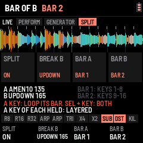

### CHAOS
**HOME › CHAOS** (0.9.75, FLEXOR: "un mathcore lite pour rajouter du chaos"; HOME's last tab, BEGINNER and
EXPERT) scrambles the break **by role**, as CHOPPAH's MATHCORE does. When a break loads, the FM-1 hears what each slice
is (its Slice Map, CHOPPAH's own: **K** kick, **S** snare, **H** hat, **P** perc, shown on the page under each
slice). Then:

| Knob | Does |
| --- | --- |
| K1 CHAOS | OFF … 100: a hit is swapped for another of **its own role** (a kick for a kick, a snare for a snare), up to 8 in 10; from 50 some are played backwards too |
| K2 MATH | OFF · 3 · 5 · 7 · 11 · 13: each bar's first N 16ths go round and round against the bar (5 against 16: a math loop) |
| K3 ROLLS | OFF … 100: snares rolled in three, hats in two |
| K4 SEED | 0 … 99: which variation. The same seed gives **the same chaos every loop**, so it grooves; turn it for another |

It works on whatever the break plays: its loop, the GENERATOR's slices, the pattern's. The kick and the drums are not
touched. SAVE keeps the four; RESET ALL turns them off. A black key set to **CHS** (ARP › BLACK K3, 0.9.76) turns CHAOS off and on in one press, its settings kept. (The TUTORIAL passes over the tab.)

### Backup and restore
**Everything the FM-1 saves** (kicks, patterns, the song, every setting; not your own breaks nor your drum samples,
which have their own pages) can be copied to a computer and put back over USB (24 Nov 2026): the site's **Backup**
page, or the LOAF BREAKER VST. A restore needs the FM-1 stopped (STOP FIRST otherwise), checks the whole file first,
then asks on the screen: **SEL** yes, **HOME** no; the FM-1 then restarts with it.

### Where things are

- **HOME**: playing, the main page. PERFORM and GENERATOR (HOME again: the next tab), the CDJ waveform on both; in
  EXPERT a third, **SPLIT** (0.9.71, below); then **CHAOS** (0.9.75, below);
  **SEL + PRESETS** there changes the kick (KICK 1–20, 0.9.26). The waveform's settings are **SYSTEM › DISPLAY** (GLO,
  then SELECT; HOME's third tab from 0.9.2 to 0.9.55, FLEXOR moved it): K1 **VIEW** (WAVEFORM or SLICES: what PERFORM and GENERATOR show; HOME held still flips
  it), K2 **WAVE TYPE** (RGB, SERATO, 3 BAND or BLUE colours), K3 **WAVE ZOOM** (how much of the past the wave holds), K4 **BREAK
  TIME** (NORMAL, or HALF: the break at half the tempo, at its own speed, its steps every other 16th, while the kick,
  the drums and the clock stay at the tempo: a 115 break under a 230 kick); SELECT stays the tempo. (0.9.25: these four
  are only here; SYSTEM no longer shows them.)
- **EDIT**: the **KICK menu**. Its picture: the kick's hit over a quarter of a second, its wave large (the cycles
  stretching as its pitch falls, squared off where it is driven), its level behind, the SUB's pitch falling in amber,
  its memory (KICK 1–20), what the part is for in a few words ("FOLD DISTORTION") and its note; under it the part's four knobs as cards, their values large. **SELECT**: the
  next section (**EDIT again**: the next sound, SNARE, HAT, CLAP, then the KICK), the kick's anatomy from its hit to its end: **ATTACK** (PRESET: K1 the built-in kicks, the part the menu opens on; CLICK, PUNCH, STACK, TOK), **BODY** (MIX, SUB, GRIT,
  SYNTH, SYNTH +, MACRO, OUT), **TAIL** (TAIL, TAIL +, BASS, MORPH, GATE), **DIRT** (DISTO, DISTO +,
  SCREAM, the layers' effects), **FX1** and **FX2** (its two FX slots, each a section of its own since 0.9.29: ALGORITHM goes through the effect's parts, MAIN, MORE, MOD or the MB COMP's), **MORE** (KNOBS until 0.9.28: KNOBS, ASSIGN, K1–K4, TOOLS, then EQ B and EQ S, its EQ's bands and shape);
  **ALGORITHM**: the next part in it (each section remembers where you were). The section's parts are a bar of tabs at
  the foot of the picture, the whole width, the one open lit (BEGINNER: those it passes over dimmed; short names
  there: SYN+ for SYNTH +, D+ for DISTO +, S FX .. C FX for the layers' effects). **MORE** puts the live knobs on the kick's picture: its first part, KNOBS, has K1–K4 turn what SEL + K1–K4
  turn (DRIVE, SCREAM, D+ SCREECH, DISTO to start: their first setting, their value large), so you hear and see the
  kick as you set them; then **K1 SET .. K4 SET**, each knob's function with all its settings (DISTO:
  AMOUNT, SUB, FIZZ, SUSTAIN; MORPH: AMOUNT, TO KICK…), the function's name by the kick's (KICK 4  K4 DISTO). They
  are the kick playing's (KICK 1–20, each its own). **On KNOBS and ASSIGN, PRESETS goes through the knobs' presets** (the
  styles, then PRESET 1–4); **on K1 SET .. K4 SET, PRESETS gives that knob another function**; SEL + PRESETS changes the
  kick there (0.9.66, FLEXOR; the other way round in 0.9.26–0.9.65) (the DISTO and SCREAM, DRIVE, DECAY, REV BASS, GLIDE, CLEAN SUB, MORPH and the rest), for
  the kick playing. **The picture has three views, EDIT held (half a second) the next:** **RGB** (to start: the
  kick's hit over half a second as rekordbox draws a track, each instant as tall as it is loud, its lows red, its mids
  green, its highs blue: a distorted kick white at the hit, orange in its body, red as its tail darkens, a SCREAM
  blue-green; the pitch falling in white; SYSTEM › DISPLAY K2: SERATO's colours instead), **WAVE** (its wave over its level, a quarter of a second, the pitch in
  amber) and **CLASSIC** (the part's knobs as bars, the layers' levels, the five drums' shapes, the break's wave
  above); the part stays where it is. **Stopped**, anywhere in the KICK menu (the big view, the
  classic view, its EQ and FX) and on the other drums' pages (big or classic), **white keys 1–4 play the KICK, SNARE,
  HAT, CLAP** once each, to hear them (the number on each drum's card; on the big views the strip names the
  drum played); playing, the keys play slices as ever. **A built-in kick on the kick selected:**
  **OUT** (BODY's last part), **K4 PRESET**: 909, 909 DRIVE, TECHNO, EARLY HC, ROTTERDAM, INDUSTRIAL, TERROR, SPINE, GABBER, MILLENNIUM, DOOMCORE (FLEXOR's, 0.9.39), on the kick
  selected (PRESETS: KICK 1–20), its volume, steps and DISTO and SCREAM kept. **A kick copied onto another:** K4 PRESET past
  them, **COPY K1 … COPY K20**: that memory's kick, its SYNTH and its knobs (KNOBS, CLEAN SUB, BASS, MORPH) onto the
  kick selected, its volume kept (pick the kick to fill with PRESETS, then the one to copy with K4). Quicker (0.9.26),
  anywhere in the KICK menu: **SEL + ARP** copies the kick (COPIED KICK n), PRESETS to another, **SEL + ARP** again pastes
  it there whole, its FX section too (PASTED KICK a > b); on a drum's page the same copies the drum's sound onto another
  of its memories. On the KICK menu, **SELECT** goes through the tabs at the top (its sections: ATTACK, BODY, TAIL, DIRT, FX1,
  FX2, MORE) and **ALGORITHM** through those at the bottom (the section's parts) (0.264). **SEL + EDIT** opens the drums; there,
  SELECT goes from drum to drum (SNARE, HAT, CLAP, and round; BEGINNER: the KICK too), each in a big view of its own: its hit drawn large over its level, its decay
  marked in amber, its memory and tune, the four drums along the bottom (stopped: keys 1–4 play them), the part's
  knobs as cards (ALGORITHM: SOUND or SHAPE, PRESETS its memories). SELECT is not the tempo there. **SEL + EDIT** opens
  the drums in the view the kick has, and **EDIT held** goes round the same three views from either page (RGB, its
  colours rekordbox's or SERATO's as SYSTEM › DISPLAY K2 sets them, WAVE, CLASSIC): one view for the kick and the drums
  alike.

  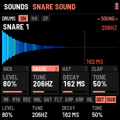
  - **The layers**: MIX, SUB, GRIT and OUT in BODY; PUNCH and CLICK in ATTACK.
  - **SYNTH** (BODY): SYNTH, SYNTH +, MACRO; in TAIL, BASS and **CLEAN MORPH** (K1 CLEAN SUB, K2 MORPH, K3 TO KICK:
    the kick's own, no knob needed).
  - **DIRT**: DISTO, DISTO + (DRIVE, TYPE, SCREECH, TAIL), SCREAM, then each layer's effect.
    (DISTO, DISTO + and SCREAM were called TERROR, TERROR + and TERROR 2 before 0.191: names a newcomer reads.)
  - **FX1**, **FX2** (FX until 0.9.28, TONE until 0.9.1): its two FX slots, a section each: ALGORITHM the effect's parts
    (MAIN, MORE, MOD), as on the FX page. Its EQ (EQ B, EQ S) is in **MORE**, after TOOLS.
  The DISTO and SCREAM's settings are the kick's own: they go with its memory. **SEL + EDIT**: the next source, DRUMS
  (SNARE, HAT, CLAP; EDIT again the next), then BREAK, then the kick.
  The kick's **SYNTH** parts (BODY) and its **BASS** (TAIL):
  - **SYNTH**: DROP (how far above its note the SUB starts its pitch drop: a soft thud .. a laser boom), TIME (how long
    the drop takes, 30–480 ms), SHAPE (the SUB's wave: a clean sine .. squared off, harder), HOLD (the SUB held at full
    before it decays, up to 250 ms: the long gabber "bwoom"; left: a shorter one).
  - **SYNTH +**: RUMBLE (the kick low-passed into a feedback line under it: the rolling hardcore rumble between kicks),
    LENGTH (the rumble's echo, 23–93 ms), ASYM (an uneven drive: even harmonics, warmer and harder), TUNE (the whole kick,
    −12 .. +12 semitones).
  - **BASS**: **GLIDE** (the kick's pitch sliding from one step's note to the next, 0–400 ms: give the kick's steps
    notes in SEQ and it slides between them), **REV BASS** (the rawstyle reverse bass: the kick's sub at its note
    swelling up between two kicks, cut as the next one hits; it goes through the kick's drive and DISTO), **START**
    (where in the beat it begins, 1/8 to 5/8), **CURVE** (how it swells: SLOW, SOFT, SHARP, SNAP).
  At 0 each sounds as the kick always did. They go with its memory (KICK 1–20); its PRESET puts them back to 0.
- **LFO** (MIX): LEVELS, ROUTING, MASTER (K1 COMP, K2 its RATIO, K3 DUCK, K4 MAX OUT; COMP's reduction metered),
  DYNAMICS (COMP's ATTACK and RELEASE, DUCK's RELEASE, DUCKS: BREAK, PERC or BOTH; ROUTING' K3 too, 0.9.64).
- **ENV**: the song. TRACKS, PLAY, DROP, BUILD, BUILD BRK, DROP BANK. (What SEL + each knob does: EDIT › KNOBS; RESET: GLO.)
- **GLO** (SYSTEM): MIDI (EXPERT: the METER), SETUP (SKIN, KICK EQ (EXPERT), MODE, AUTO SAVE: K1–K4, top to bottom; PRESETS the skin too; SEL WHITE on / off in 0.9.70, gone in 0.9.71), DISPLAY (0.9.56: VIEW, WAVE TYPE, WAVE ZOOM, BREAK TIME, HOME's before; SETTINGS until 0.9.67), SCREEN FX (several at once, keys 1–7; K3 DRUM FILTER, the drums' filter's kind, K4 KICK SWITCH; each effect's card a small picture with that effect done to it, lit when on, since 0.9.30; the waves' colours are SYSTEM › DISPLAY's WAVE TYPE since 0.9.25; EDIT VIEW and DRUM VIEW ZOOM are KICK › MORE › TOOLS since 0.9.29), SCREEN SET, LIGHTS, RESET.
  The break's PITCH, GRAIN and SNAP are SOUNDS › BREAK; SWING is PATTERN › GROOVE.

### The CDJ view (HOME)

**PERFORM and GENERATOR show what leaves the mix** (the break, the kick, the drums, the effects; before MASTER)
scrolling in from the right, the playhead at the right edge, as a track on a CDJ. Each column is coloured as
rekordbox's RGB waveform: the lows red, the mids green, the highs blue, mixed (a kick reads red to orange, a snare
green to cyan, the hats blue), as tall as its peak. 4 beats fill the screen; the beats are ticked top and bottom (the
bar's first lit) and the bar and beat counted top left. While a track plays, a line along the top shows how far
along it is, and "DROP IN 4" counts the bars to its next DROP. **Hold HOME** (a third of a second) for the slice blocks
instead, hold it again for the waveform; neither moves to HOME's next part.

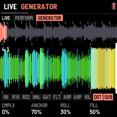 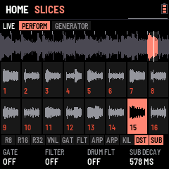

### Tracks and drops (ENV)

**ENV** opens TRACK; **SELECT** goes through its tabs: TRACKS, PLAY, DROP, BUILD, BUILD BRK, DROP BANK (0.9.2: ALGORITHM still the items on
TRACKS); **ENV again** goes back to HOME (ENV held on TRACKS: a space after the item, as before). The tempo is SELECT's
on HOME and the other pages (the metronome and tap tempo are gone).

- **TRACKS**: eight tracks (**PRESETS** picks one), each up to 32 items in four rows of eight: a pattern (P1–P64)
  played for its loops (×1–×16), a **DROP** (the build, then the drop into the pattern after it), and its END.
  **ALGORITHM** the item, **K1** its **kick**: SAME (the one playing goes on) or KICK 1–20, taken as the item's pattern
  comes in (playing from it: at once; a DROP into it: with the drop; its cell shows it, "K7"); on a DROP, the kick its
  **build** plays (its kick roll, say), the one before back at the drop ("DRP K5"), **K2** what it is: END, EMPTY, DROP 1–8, DROP, P1–P64 (DROP just left of P1: the drop selected; further left DROP 8 … DROP 1, the item's own drop, picked as its build begins, the cell showing D3; 0.9.58; EMPTY, left of DROP, empties the case and keeps its place: ENV held on it,
or K2 left once more, deletes it, the rest moving up; then K2 left does nothing until the knob has rested 0.7 s, so a
hard turn deletes one item, not the ones moving into its place, 0.9.26),
  **K3** its loops (on a DROP: **STUTTER**, OFF / ON: its build rolls the break, 8ths, 16ths, then 32nds, over BUILD's
  style; the item shows "DRP S"; 0.9.26), **K4** its **break** (on a DROP: **GAP KEEPS**, what plays in the silence
  before the drop, BUILD's K4 GAP its length: NOTHING, as before; BREAK, the break on alone; DRUMS, the kick and the
  drums (the build's roll); ECHOES, the sources quiet and the FX's reverb and delay ringing on; whatever it keeps,
  heard without the build's filter and riser; the item shows B, D or E; 0.9.26): SAME (the one playing goes on) or one of the bank's, in with the item
  (swapped at the bar's end, as ALGORITHM does; a cell with its own break shows it, "X4 B3"; a DROP into it brings
  it in, in DROP BREAK's place). What the track does at its end (LOOP, STOP, HOLD) is on **PLAY**'s K3.
  ALGORITHM moves along the items (the break stays as it is: SEL + ALGORITHM changes it). A
  **white key** puts its pattern at the item and moves to the next one. **ENV held** (0.45 s) makes room: the items after the one edited move one place right and an empty item (a + in an outline) opens after it, the one
  edited staying where it is; the cursor goes onto it, for a white key (a pattern) or **K2** (a DROP; K2 left: the
  space gone again). An empty item left is played past. **ENV held on an empty item** takes it out: the items on
  its sides close up, the cursor on the one before. ENV let go quickly: the next part, as ever.
  **SEL + PLAY** makes the item edited the one the track starts from (a flag at its corner, "FROM 2" at the top; again
  on it: from the first again); it is the track's own and saved with it. **PLAY** on TRACKS plays the track from there
  and stays on TRACKS (PLAY again stops it).
- **PLAY**: a radio. **K1** tunes it: the needle glides along the dial to the track (1–8, the ones with something in
  them lit), the big knob turns with it; the station shows the track's length, its items, where it starts and what it
  does at its end. **K2** the item it starts from (the same as TRACKS' SEL + PLAY, each track its own). **PLAY** (or white keys 1–8: that track) plays it from
  bar 1 and goes back to HOME; the header shows T1 … T8. Each pattern comes in at the end of the last loop of the one
  before; a DROP's build starts at the next bar. **SEL + ENV** while a track plays drops into its next pattern and the
  track goes on from there. PLAY again stops it.
- **DROP**: **K1** the build: NONE (the bar playing ends in the drop), 1, 2, 4 or 8 bars; **K2** the pattern a SEL + ENV
  drop brings in (NEXT, SAME: the pattern playing again from its start, 0.9.55, FLEXOR, or P1–P64); **K3** the break it brings in (SAME, **NEXT**: the break after the one playing, round, so each drop brings in a new one, 0.9.71, FLEXOR; or any break, the firmware's and yours); **K4** the crash's
  level; **PRESETS: BUILD KICK**, the kick the build plays (SAME, or KICK 1–20: for its kick roll, say), the one
  before back at the drop (a track's DROP item: its own, TRACKS K1).
- **BUILD**: how the build before a drop sounds, so drops don't all sound alike. **K1 STYLE**: SNARE ROLL (the
  snare speeding up, as ever), KICK ROLL (the kick doing it), KICK+SNARE (the two in turn), STUTTER (the drums out, the
  break itself rolled in 8ths, 16ths then 32nds), SWEEP ONLY (the drums play on, only the filter and the noise build),
  RANDOM (each build picks one). **K2 SWEEP**: HIGH-PASS (as ever), LOW-PASS (closing down to ~400 Hz), NONE, RANDOM.
  **K3 RISER**: the rising noise, OFF to 200 % (100 %: as it was). **K4 GAP**: silence just before the drop (none, a
  16th, an 8th, a beat, half a bar), so the drop hits out of nothing. **PRESETS: TEMPO RISE**, OFF to +30 %: the
  tempo climbs with the build and drops back to yours at the drop (not while following a MIDI clock).
- **BUILD BRK** (BREAK until 0.9.67; 0.9.50, FLEXOR): what the break does in the build, over any BUILD STYLE (the drums' roll goes on under
  it). **K1 BREAK**: STILL (it plays on, as before) or ROLL (it rolls on shorter and shorter, at the R8, R16 then R32
  pads' rates, let go at the drop). **K2 ROLL FROM**: when the roll begins: the BUILD START, HALF WAY, or the LAST
  QUARTER (still before it). **K3 GAP KEEPS** (0.9.58): what plays in BUILD's GAP before this drop: NOTHING, BREAK, DRUMS or ECHOES (a track's DROP item's own K4 GAP KEEPS, when set, wins). RESET's BUILD sets them back to STILL and NOTHING.
- **DROP BANK** (DROPS until 0.9.67; 0.9.58, FLEXOR: drops made like patterns, a different one on each DROP of a track): **DROP 1–8**, each a whole
  drop: DROP's BUILD, AFTER, DROP BREAK, CRASH and BUILD KICK, BUILD's STYLE, SWEEP, RISER, GAP and TEMPO RISE, BREAK's
  STILL / ROLL, ROLL FROM and GAP KEEPS. The page (SONG's last tab) shows the eight as cards (their build, style and
  what comes after), the one selected lit: **white keys 1–8** (or **K1**) pick it, **K2–K4** set its BUILD, STYLE and
  AFTER DROP at once. The one selected is the one SEL + ENV plays and the one DROP, BUILD and BREAK edit (each says
  DROP n, bottom right). **SEL + ARP** copies it; pick another, SEL + ARP again pastes it there. On TRACKS, a DROP
  item's K2 gives it its own (DROP 1–8, left of DROP): as its build begins, that drop is selected (as an item's kick
  is). SAVE keeps them; an FM-1 updated starts with all eight as its drop was; RESET ALL sets them as they start.
- **The live knobs** (EDIT › KNOBS): what SEL + each knob does, on any page. On the KICK menu's KNOBS section,
  **ALGORITHM** goes to K1 SET .. K4 SET, and **PRESETS** there gives that knob its function: SCREAM, DISTO, D+ DRIVE, D+ TYPE, D+ SCREECH, D+ TAIL (DISTO +'s settings, one each),
  DRIVE (the kick's INTENSITY), DECAY, REV BASS, GLIDE, CLEAN SUB, MORPH, PITCH DROP, RUMBLE, PUNCH, DRUM FLT,
  HOLD, KICK FX or SUB DRIVE (0.9.62: the SUB layer's DRIVE gain; 0.9.66, FLEXOR: the gain alone, it never turns the drive on: the SDR key does, and it says OFF beside the gain while off). They start as K1 DRIVE, K2 SCREAM, K3 D+ SCREECH, K4 DISTO. K1–K4 then set the
  function's settings (K1 is what SEL + its knob turns). DUCK and COMP are not here: the MIXER (LFO) has them, MASTER and
  DYNAMICS.
  - **SCREAM**: AMOUNT, SUB (what stays clean under it, ~48–250 Hz), SCREAM (the mids it pushes, ~150 Hz–2.4 kHz),
    PUSH (how hard).
  - **DISTO**: AMOUNT, SUB, FIZZ (its top, darker or brighter), SUSTAIN (the fold dying with the kick, or a wall).
  - **DISTO +** (its settings on EDIT KICK too): DRIVE (the fold's gain, apart from AMOUNT's mix), TYPE (FOLD the
    scream, CLIP squared off, CRUSH in steps, RECT rectified: an octave up, hollow and metallic, TUBE uneven: warm
    and fat; since 0.255 HALF one side alone, pushed: dirty and hollow, SINE folded round a sine: it sings as DRIVE
    goes up, WRAP past the edge back in from the other side: digital and harsh, FUZZ all but a square: a thick buzz),
    SCREECH (a resonant band, ~500 Hz–5 kHz, the whistle; OFF to the left),
    TAIL (the distortion dying fast, or hanging on between kicks).
  - **DECAY**: the SUB's tail (HOME's K4 the same). (TUNE is no knob's: SYNTH +'s K4 has it; a knob given it
    before has its own function again.)
  - **REV BASS**: AMOUNT, START, CURVE (the kick's BASS part). **GLIDE**: its TIME.
  - **CLEAN SUB**: AMOUNT. A pure sine at the SUB's note (its drop, its tail) laid **after** all the distortion, the
    distorted kick's own lows (under ~90 Hz) taken out as much: the round, fat bass under the dirt, as new-school
    gabber and uptempo do.
  - **MORPH**: AMOUNT, TO KICK. The kick playing slides towards another of the twenty memories: every level, pitch,
    decay, tone, DISTO and SYNTH setting in between (the effects and DISTO +'s TYPE the nearer one's). From a round
    kick to a saturated one over a build, back at the drop.
  - **PITCH DROP**: AMOUNT, TIME (SYNTH's DROP and TIME): how far and how fast the kick's pitch falls, a short "tok"
    or a long dive. **RUMBLE**: AMOUNT, TIME (SYNTH +'s): the tail rolling between kicks. **PUNCH**: the MACRO's PUNCH
    (level, sweep, click): the attack. **DRUM FLT**: the drums' filter (SEL + SELECT's), on a knob. **HOLD**: SYNTH's
    HOLD, the kick square for longer before it falls. **KICK FX**: FX 1 MIX, FX 2 MIX, the kick's own two FX slots
    more or less.
  - **ASSIGN** (STYLE until 0.9.1; KNOBS' last part, ALGORITHM back from KNOBS): **K1–K4** each give their own knob its function, one at a
    time (the cards show them); **PRESETS** turns through the styles (0.9.66; SEL + PRESETS the kick there), each giving the four at once (the kick
    playing's): **TERROR** (DRIVE, SCREAM, D+ SCREECH, DISTO, as they
    start), **EARLY NEXT GEN** (PITCH DROP, RUMBLE, PUNCH, DRUM FLT), **HARDCORE** (DRIVE, PUNCH, DECAY, DISTO), **NEW
    SCHOOL** (DRIVE, CLEAN SUB, D+ TYPE, DISTO), **RAWSTYLE** (REV BASS, GLIDE, PITCH DROP, D+ TAIL), **INDUSTRIAL** (T+
    SCREECH, D+ TYPE, DECAY, KICK FX), **FRENCHCORE** (DRIVE, DECAY, SCREAM, PITCH DROP), **LIVE BUILD** (DRUM FLT, MORPH,
    RUMBLE, HOLD), **FLEXOR** (0.9.62: DRIVE, D+ TYPE, SUB DRIVE, DISTO; last, before PRESET 1): DRIVE always on K1, DISTO always on K4. The kick's picture shows the style ("PRESETS: EARLY NEXT GEN", CUSTOM once a knob is changed on its
    own); their settings stay where they are. Each card also shows its function's value by the knob's name, and its bar
    moves as SEL + that knob turns it (SEL twice: locked, both hands free).
    After LIVE BUILD (or back from TERROR), **PRESET 1–4** are yours: the four functions *and their values*, the same
    for every kick. An empty one ("PRESET 1 (EMPTY)") gives the knobs back as you had them before PRESETS turned;
    **SAVE** there stores them in it ("PRESET 1 STORED, SAVED", everything saved with it). A stored one gives the kick
    playing its four functions and puts their values where they were: any kick, KICK 1 as KICK 10. To change one: pick
    it, change the knobs (SEL + them, or K1–K4 their functions), SAVE again.
  Every one of them has its place on the KICK menu too, the kick's own with no knob given it: the DISTO and SCREAM and DISTO +
  (DIRT), DRIVE (BODY's MACRO, INTENSITY), DECAY (BODY's SUB), REV BASS and GLIDE (TAIL's BASS),
  CLEAN SUB and MORPH (TAIL's CLEAN MORPH).
  **KNOB is the kick's own**: each kick memory (KICK 1–20) keeps its four functions and their settings (CLEAN SUB,
  REV BASS, GLIDE, MORPH and its target; the DISTO and SCREAM, TUNE and DECAY were already its own). Change kick (PRESETS on the KICK
  menu) and the knobs are that kick's; come back and they are as you left them. KNOB shows
  whose they are (KICK 4) at the bottom. RESET KNOB puts back the kick playing's.

**No saturation.** Whatever the effects and COMP do, a last guard holds every peak under full scale (-0.4 dB) by turning
it down at once, never clipping it square. And **MAX OUT** (the MIXER's MASTER, K4) sets how loud the output gets with MASTER
all the way up: -3 dB to start with (headroom for the FM-1's output and your speaker), right to 0 dB, left down to
-12 dB.

**SEL held a moment, or locked, shows the SEL + K1–K4 functions at the foot of the screen** (their names in amber, their values: what EDIT KICK › KNOBS gave them), back to the page's knobs when SEL goes up or is freed (0.258). While a black key is held with SEL (held or locked), its own knobs win: the foot shows that effect's settings and K1–K4 tune them (a roll's RATE, BRK FLT…; KIL's and X2's LATCH), SEL + K1–K4 again once the key is let go (0.9.57, FLEXOR). **SEL ×2 (two quick clicks) locks it down**: SEL blinks (0.9.46) and counts as held, so every SEL combination works with one hand
(SEL + a knob, SELECT, PRESETS, ALGORITHM, ENV…); **SEL pressed again frees it**.

**SEL + ENV** (playing) asks for the drop (SEL ×3 no longer does: too easy by mistake): the build starts at the next bar, so the drop always lands on a bar line.

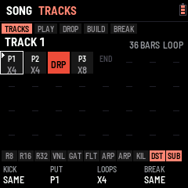 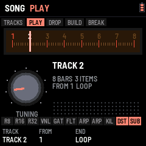 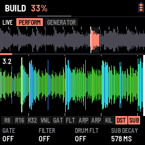
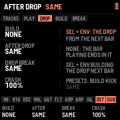 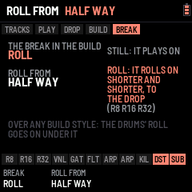

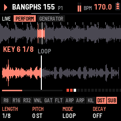

### Your own breaks (BREAKS)

Beside the eight built in, the FM-1 holds breaks of your own (0.9.32, from CHOPPAH 1.4's break manager): 232 KB of
room, five to seven breaks of the library's size. In the page's library, a break built into the firmware is marked
**IN THE FIRMWARE** (an amber edge), one already in your list **IN YOUR LIST** (a green edge; 0.9.70, FLEXOR).
The site's [Breaks](https://flexor-r.github.io/loaf-breaker/breaks/) page, in Chrome or Edge on a computer, does it:

1. **The library**: the project's breaks, over ninety (the Cyberworm Amens, the Huge Amen pack, the classics, FLEXOR's hardcore breaks under the track's whole name, the FM-1's short name beside it), each
   made as the built-in ones (two bars, levelled, sixteen slices on an even grid). Filter them, search a name or a tempo,
   **▶** to hear one chopped as the FM-1 plays it (Play, Chop, the tempo, the keys 1–8 and Q–I), **+ Add** to put it in
   your list. The eight built in are marked: they are on the FM-1 already.
2. **A sample of your own**: a drum loop of whole bars in any format the browser plays; the page guesses its bars and
   tempo, makes it as the built-in ones and plays what the FM-1 will play; **+ Add to your breaks**. Its **Level**:
   as the built-in breaks (−12 LUFS, the level as heard; to start) or the loudest at full scale; its **Slices** on an
   even grid (to start, as the built-in breaks) or on the hits. The page keeps both for the next sample.
3. **Your breaks**: the list, as much as fits in the FM-1's two places for them, 140 KB and 92 KB (four breaks at most
   in each; a library break takes 29 to 47 KB: five to seven in all). The page picks each one's place; the two meters say
   the room taken, and a break that fits in neither is refused with the room left. Remove one, hear one. **Connect** the FM-1 by USB, **stop** LOAF BREAKER, **Send to the FM-1**:
   the list replaces what was on it (sending an empty list deletes them). Connected, the page reads back the ones on it.

Your breaks come **after the eight built in** on ALGORITHM (break 9 on, in the list's order; your saved patterns and
tracks keep their breaks). The FM-1 says RECEIVING A BREAK, then plays the first of them. They stay through updates of LOAF BREAKER;
RESET ALL and WIPE MEMORY keep them.

### Key loops

Hold a white key and it loops: a window that starts in its slice plays again and again in time, until you let go
(playing, the break carries on from there; stopped, it ends with the window). Held for a moment, the slice blocks
give way to **the key's view**: its window zoomed to the screen's width, the part this repeat has played lit (from
the right when it runs backwards), the playhead, the slice lines inside the window, this repeat's progress and a dot
for each repeat. A quick tap plays the slice once and keeps the blocks.

While the key is held, **K1–K4 set its loop**, for that key only and for **the break playing** (0.9.71, FLEXOR: each
break keeps its own white keys, to chop each one its way: change the break and its own come back; SAVE keeps every
break's; a key with a loop of its own has a dot on its block):

| Knob | Sets | Range |
| --- | --- | --- |
| K1 LENGTH | How long the window is, shown as music for this break | 1/8 of a slice … 16 slices (2-bar breaks: 1/64 … 2 BAR), with the jungle chops between: **3/32** after 1/16 (0.9.30), **3/16** after 1/8 and **3/8** after 1/4 (0.75, 1.5 and 3 slices; 0.9.29, from CHOPPAH 1.3.1) |
| K2 PITCH | The key's own pitch, on top of OCT | −12 … +12 semitones |
| K3 MODE | LOOP · PING-PONG (every other repeat backwards) · REVERSE · ONE SHOT (once, then quiet while held) | |
| K4 DECAY | Each repeat fades from full (0.9.50, FLEXOR: in START's place; the window starts on the slice) | OFF, then 25 ms … 2 s (to −40 dB) |

SEL while a key is held puts its loop back to one slice, no pitch, LOOP, no DECAY. With several keys held the
last one pressed loops; let it go and the lowest still held takes over. Pads still work on top: REV turns the loop
round, ROLL and FREEZE take it over while held.

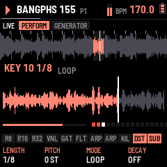

### Slice effects

Every slice can have an effect of its own, there whenever that slice plays: in the loop, from its key, in a roll.
Hold the key and press **FX**: K1–K4 turn from its loop to its slice's effect (FX again turns them back; the knobs
stay on the layer you left them on for the next key). A block whose slice has an effect shows its tag (LP, HP, CR,
DR, RM, EC, VB; LV for a level alone). SEL while held resets the layer shown.

| Knob | Sets |
| --- | --- |
| K1 EFFECT | OFF · LO-PASS · HI-PASS · CRUNCH · DRIVE · RING MOD · ECHO (throws the slice into the FX chain's delay) · VERB (throws it into the reverb) |
| K2 AMOUNT | How much: darker, thinner, crunchier, harder, the ring's pitch, the throw's level |
| K3 TONE | The filters' resonance, RING MOD's mix |
| K4 LEVEL | The slice's own level: accents, or ghost notes of single hits |

ECHO and VERB throw only that slice: put a DELAY (or a REVERB) in the FX chain with its SEND (MIX) low, and only the
slices you marked ring out, the classic dub throw. (Without a DELAY slot, ECHO goes into the delay after the chain.)

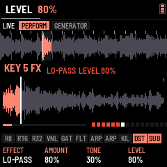

## 4. The pads

The black keys act while held and combine. Which key does what is a **layout** (ARP › BLACK, below): CHOPPAH's,
left to right R8 R16 R32 REV FRZ HLF VNL GAT RND FLT DUB (a new FM-1's, after RESET ALL too; BEGINNER keeps the layout EXPERT left, 0.9.23),
FLEXOR LAYOUT (R8 R16 R32 ARP ARP TRI X4 X2 SUB DST KIL since 0.9.61, FLEXOR (KIL and SUB swapped; 0.9.58-0.9.60 KIL DST SUB): two ARP keys, the second on RISE, then the kicks in triplets, X4 and X2; REC, as a key, KILL BREAK; VNL GAT FLT ARP ARP from key 4 in 0.9.53-0.9.57, RND HLF FLT ARP VNL in 0.9.26-0.9.52) or CUSTOM, each key any of the functions below. (HOME's K1 is
the gate and K2 the DJ filter as well.) While a pad is held, the slice blocks give way to an
animation of what it does, and **K1–K4 tune that pad** (the foot shows its settings; SAVE keeps them):

| Pad | Does | K1 | K2 | K3 | K4 |
| --- | --- | --- | --- | --- | --- |
| R8 · R16 · R32 | Roll from the next 16th | RATE (3/8, 1/4, 3/16, 1/8, 3/32, 1/16, 1/32, 1/64, then the triplets; the dotted ones since 0.9.30) | BRK FLT (HOME's break filter: roll and filter at once, 0.9.40; what the roll takes, BREAK, KICK or BOTH, is MIX › ROUTING K4 ROLL) | DRUM FLT (HOME's drums' filter) | DECAY: DOWN (each repeat quieter) or UP (a swell up to full) |
| REV | Reverse | Speed | | | LATCH: ON, a press turns it on and the next off (0.9.26) |
| FRZ | FREEZE: the slice playing loops while held | LENGTH: the slice, 1/2, 1/4, 1/8 | PITCH (±12 semitones) | | LATCH: ON, a press turns it on and the next off (0.9.26) |
| HLF | Half speed | Speed | MASTER TEMPO: the pitch kept (ON) or dropped | LATCH: ON, a press turns it on and the next off | |
| VNL | VINYL BREAK: the record slowing to a stop, spinning back up when let go; with THRU BOTH or KICK the kick and the drums slow with it, their steps following the record further and further apart down to the stop (0.9.67, FLEXOR; before: none while held) (the screen: a Technics platter over the wave, its strobe dots racing back as it slows, the LOAF BREAKER face turning on its label, the speed and its semitones on the right; 0.9.30) | THRU: the break, the kick or both | LATCH (0.9.64: ON, a press stops the record, the next spins it back up; HOME's break filter until 0.9.63) | STOP (beats) | SPIN UP |
| GAT | Gate: the break chopped on the beat | RATE | LENGTH (how much of each gate sounds) | | LATCH: ON, a press turns it on and the next off (0.9.26) |
| RND | Random slices | Amount | Random pitch | | LATCH: ON, a press turns it on and the next off (0.9.26) |
| FLT | Filter throw: the DJ filter sweeps to its target while held, back when let go | TARGET (low-pass left, high-pass right) | RESO | SPEED | THRU: BREAK (the break, as ever), DRUMS (the kick, the snare, the hat, the clap), BOTH (0.9.26) |
| DUB | Dub throw: the break into an echo while held, its tail ringing out | TIME (1/8, 3/16, 1/4, 3/8) | FEEDBACK | TONE | MIX (with a DELAY in the FX chain: that slot's own four) |
| ARP | Its ARP effect over the mix, while held (or latched): DIVE, RISE, RADIO, CRUSH, LO-FI, DIST, RING, CHOP, GATE, DUCK, PAN, BOOM, JET, KICK X2, KICK X4, KICK TRI | EFFECT | AMOUNT (that effect's) | TIME: RATE for CHOP, GATE, PAN; SWEEP for DIVE, RISE | LATCH |
| Several ARP keys (0.9.45) | Put ARP on more than one key (CUSTOM, ARP › BLACK): each is its own, with its own EFFECT and its own LATCH, and they play together (hold two, latch one and hold another…). The knobs tune the ARP key pressed last (its number shows under FX: MORE). Shared by all: ON / OFF, RATE, SWEEP, and each effect's AMOUNT and THRU (0.9.50: THRU each effect's own) | | | | |
| ARP, FX while held (MORE) | | THRU: BREAK, KICK or THRU (everything; LFO's ARP the same) | ON / OFF (OFF: K1 browses silent) | RATE (1/4 … 1/32) | SWEEP (1/4 bar … 2 bars) |
| KIL | While held, the sequencer's kicks are quiet; let go, they play again (a kick roll still plays). When the kicks come back, the drums' filter (SEL + SELECT) goes back to OFF at once, so a drop is never filtered by mistake (0.9.50, FLEXOR); unless you turned it while the kicks were quiet: then they come back through the filter you set (0.9.64, SYSTEM › SCREEN FX K4 KICK SWITCH: SMART; FLT OFF always OFF, FLT KEEP never) | LATCH: ON, a press quiets them and the next brings them back | | | |
| X2 | KICKS X2 (0.9.48): the kicks doubled, for a beat twice as violent. Every odd step (1, 3, 5 … 15) of a bar that has kicks plays one, with the last kick's note: four to the floor becomes eight; the even steps play as programmed. KIL still silences them. In no preset layout: put it on a key of CUSTOM (ARP › BLACK, K3) | LATCH: ON at first, a press doubles them and the next brings them back; OFF, doubled while held | | | |
| X4 | KICKS X4 (0.9.55, FLEXOR): a kick on every step of a bar that has kicks (four to the floor becomes sixteen), with the last kick's note. KIL still silences them. CUSTOM only | LATCH: ON at first, a press on and the next off; OFF, while held | | | |
| TRI | KICK TRIPLETS (0.9.55, FLEXOR): the kicks in 8th-note triplets, three a beat, from the next beat, the pattern's kicks out meanwhile (a roll key's KICK ROLL plays over it). CUSTOM only. (0.9.67, FLEXOR: as X2 and X4 in every way) KIL quiets the triplets while held and leaves TRI as it is: let go, they play on; TRI turns on and off whatever KIL does. Before 0.9.67: KIL cut it: pressing KIL turned TRI off and the triplets are quiet (the ARP's KICK TRI too), and TRI cannot be turned on while KIL holds the kicks (it says KICKS KILLED; 0.9.57, FLEXOR) | LATCH: ON at first, a press on and the next off; OFF, while held | | | |
| DST | A switch: a press, the kick's DISTO off, the next on again; its amount is never touched (at 0 % it stays 0 %: turn DISTO up to hear it). Lit while it is ON, even at 0 % (0.268); the kick's own (KICK 1–20): another kick picked (PRESETS, a track's item, a build) brings its own ON or OFF, the key lit with it; saved with SAVE. In BEGINNER too when its layout has DST (0.9.24) | | | | |
| SUB | A switch (0.9.43): a press turns the kick's **SUB FX** off (the SUB layer's effect, whichever is set in EDIT: DRIVE, CRUNCH, FILTER, RING), the next on again; the effect and its settings are never touched (it adds no effect of its own any more: SUB DRIVE is EDIT's). The kick's own, as DST: each kick brings its own ON or OFF, the key lit while ON. A built-in kick picked on PRESET sets DST and SUB as it is made: DST on again if it has DISTO (TERROR, SPINE, EARLY HC, INDUSTRIAL, 909 DRIVE, GABBER, MILLENNIUM, DOOMCORE), SUB on again if it has a SUB FX (TERROR, SPINE) | | | | |
| DRV | A switch (0.9.43): a press, the kick's DRIVE off, the next on again; its amount is never touched. Lit while it is ON; the kick's own (KICK 1–20), as DST; a built-in kick picked with a DRIVE puts it on again. In no preset layout: put it on a key of CUSTOM (ARP › BLACK, K3) | | | | |
| SDR | SUB DRIVE (0.9.57, FLEXOR: back, as the SUB key was until 0.9.42): a press puts the kick's SUB layer through its DRIVE (EDIT's SUB FX set to DRIVE; its mix up from nothing, the SUB FX switch on again so it is heard), the next press turns that effect OFF. Lit while on. Beside SUB, which stays the SUB FX switch (whichever effect, untouched). In no preset layout: put it on a key of CUSTOM (ARP › BLACK, K3) or as a SEL BLACK function | | | | |
| KBR | KILL BREAK (0.9.58, FLEXOR): the break out while held (the kick and the drums play on), back when let go | MODE: FADE (out over TIME), CUT (out at once), BAR END (out at the bar's end, its last 8th thrown into the reverb: the FX chain's REVERB, or a plate of its own if there is none; its tail rings on), END FADE (0.9.60, FLEXOR: the break plays on to the end of its loop, its two bars, then fades out over TIME) | TIME: FADE's and END FADE's length, 1/16, 1/8, 1/4, 1/2, 1 BAR, 2 BARS; on BAR END, **ECHO** (0.9.60, FLEXOR): its last 8th also thrown into an echo that repeats and fades, OFF, 1/8, 3/16 (to start), 1/4, 3/8 apart (the DUB delay, or the FX chain's DELAY if there is one) | REVERB: BAR END's, how much of its last 8th goes in (0–100 %) | LATCH: ON, a press out, the next back. In no preset layout: CUSTOM (ARP › BLACK, K3) or SEL BLACK |
| CHS | CHAOS on / off (0.9.76, FLEXOR): a press turns HOME › CHAOS off (its settings kept), the next on again; on with nothing set, CHAOS 40 to hear it. Lit while CHAOS is heard; a CHAOS knob turned on its page turns it back on. In no preset layout: CUSTOM (ARP › BLACK, K3) or SEL BLACK | | | | |

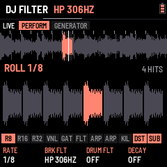
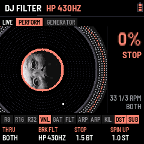

## 5. Patterns and the sequencer

LOAF BREAKER holds **64 patterns**, P1–P64. Each is the break's 32 steps (2 bars), each step playing the loop's own
slice (LOOP, where the generator can move it), a slice of its own, or nothing; and the drum lanes (kick, snare, hat,
clap), each 32 steps in a new pattern whatever the mode (0.9.32, FLEXOR; LENGTH: 16, 32 or 64). **PRESETS** picks the pattern on most pages (left of P1: P64); while playing, the
next one starts when the loop comes round (the header shows "P2>").

**Four groups of 16.** The FM-1 keeps one group in memory at a time: P1–16, P17–32, P33–48 or P49–64; the others wait
in its flash. Within a group nothing changes. Going to another group reads it in, so the sound plays on, with one
exception: if the group you leave has changes not yet saved, they must be written first, and a write cuts the sound for
a moment. So, stopped, they are saved on the way (no sound to cut); playing, the FM-1 stays where it is and says
**SAVE OR STOP**: press SAVE (or stop), then pick the pattern again. The same goes for a track or a drop that leads into
another group. A new group starts with 16 empty patterns; what you had before this version is P1–P16.

**SEQ** opens the sequencer. **ALGORITHM** picks what the white keys edit: every lane of the grid, top to bottom and round (the break's rows shown, then each bar of the kick, the snare, the hat and the clap; 0.9.31, FLEXOR). **SELECT** picks the view: **FULL** (the break's rows and the drums, as to start), **DRUMS** (the drums alone), **SETTINGS** (below) (0.9.2: **SEQ again** goes back to HOME):

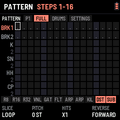 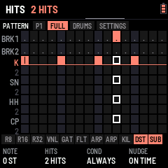

| Lane | White keys | K1 | K2 | K3 | K4 |
| --- | --- | --- | --- | --- | --- |
| STEPS 1-16, STEPS 17-32 | Pick a step to edit (outlined) | SLICE: OFF · LOOP · 1–16 | PITCH: −12 … +12 | HITS: ×1–×4 (a ratchet in the step) | REVERSE |
| KICK, SNARE, HAT, CLAP | That lane's 16 steps, on and off (as the key comes up) | FILL: 0–16 hits spread evenly from the downbeat (Euclidean) | DRUM FLT (HOME's drums' filter) | Left CLEAR, right 4X4 (the lane's bar shown) | LENGTH: 16, 32 or 64 steps, every drum (the snare, the hat and the clap 64 since 0.9.30: their steps 33–64 share the HITS, CHANCE and NUDGE of 1–32) |
| **A step held** (a drum lane) | its own, the foot naming them | NOTE: −8 … +7 semitones (the kick's) | **HITS**: 1–4, the step taps that many times in its 16th | **COND**: ALWAYS, 75 %, 50 %, 25 % (it plays that often), 1:2 (the first loop of two), 2:2 (the second), (FILL and NOT FILL, from before 0.244: always) | **NUDGE**: on time .. 7/16 of a step late |

The upper strip shows the half's 16 steps (a number: its own slice; a dot: LOOP; a dash: off; a mark under it: hits
or reverse), the step playing lit; the lower strip all three drum lanes.

**REC** records: while it is lit and the break plays, every white key you press (on HOME and the other pages where
the keys play slices) is written into the pattern at the step it lands on, and so are MIDI notes: 48–63 as slices,
36 / 38 / 42 into the kick, snare and hat lanes. REC again stops. **SEL + REC** clears: on SEQ the lane shown, on any
other page the whole pattern. **SEL + SAVE undoes**
either (and FILL, CLR / 4X4 and COPY on a drum lane, and the SEQ-held moves below); press it again to redo. SAVE keeps
all 16.

**SEQ's hands** (on SEQ):
- **Playing, the keys follow the bar playing**: on a lane of 32 or 64 steps (the break, a kick of 64, a snare of 32),
  the lane shown moves on with the bar the sequencer plays, so you write where you hear. ALGORITHM picks a lane by
  hand: then it stays put until you stop.
- **SEQ held + white key 1–4**: the bar shown copied onto bar 1–4 of the same lane (its steps, their HITS, COND, NUDGE
  and notes): write the kick's first bar, then copy it onto 2, 3 and 4.
- **SEQ held + K1**: the whole lane (every bar of its drum, or the break's 32 steps) a step later (right) or earlier
  (left), round: shift a FILL or look for a groove.
- **SEQ held + REC**: every drum lane of the pattern cleared, the break's steps kept.
- **REC on, playing, a drum lane**: any white key plays that lane's drum and writes it at the nearest 16th, where it
  lands: tap the rhythm in rather than draw it.

### ARP (the ARP page until 0.9.67)

**ARP** opens its page (ARP until 0.9.67, FLEXOR): sixteen effects over everything that plays, one on each white key (DIVE, RISE, RADIO,
CRUSH, LO-FI, DIST, RING, CHOP, GATE, DUCK, PAN, BOOM, JET, then the kicks' three: KICK X2, KICK X4, KICK TRI, as the
black keys X2, X4, TRI; 0.9.55, FLEXOR: WAH, WOBBLE and REESE gone), on while the key is held, any
together. **ALGORITHM** goes through the sixteen in order, round, without playing them (0.9.52, FLEXOR; SEL + ALGORITHM the break here); the one it lands on is the one the knobs tune. **K1** the amount of the one touched last, **K2 THRU** what that effect takes (0.9.50, FLEXOR: each effect its
own, kept by SAVE): BREAK (the break and the drums), KICK (the kick alone) or THRU (the whole mix); its card says BREAK or
KICK, so some effects can work on the break while others work on the kick, together. **K3** its RATE (CHOP, GATE,
PAN) or SWEEP (DIVE, RISE), the one it has, **K4** LATCH: on, a key switches its effect on and off (and what is latched
stays on on the other pages). The page and the ARP black key share one effect (0.9.27; with several ARP keys, the one pressed last, 0.9.45): a white key touched here is the ARP key's effect, and the one K1 tunes; the ARP key's K1 turns it, the page follows; AMOUNT, THRU, RATE and SWEEP are the same on both (the ARP key's THRU, FX: MORE K1, is its effect's). The white keys of the effects on are lit (held, latched, the ARP key's). (The FILL that ARP held
played from 0.1xx to 0.243 is gone, LOAF BREAKER 0.244.)

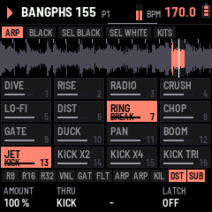

In EXPERT the page has three tabs (**SELECT** goes to the next, or back to the left, 0.9.52; **ARP** again goes back to HOME; their names short
since 0.9.50, FLEXOR; BLACK and SEL BLACK in full since 0.9.53): **ARP** (the effects above), **BLACK** (the black keys) and **SEL BLACK** (the black keys with SEL)
(SEL WHITE, the white keys' shortcuts with SEL, and KITS were there in 0.9.50-0.9.70: gone in 0.9.71, FLEXOR). **BLACK** lays out the black keys: **K1 PRESET**, CHOPPAH (CHOPPAH's eleven, the ARP
key not among them), FLEXOR LAYOUT (R8 R16 R32 ARP ARP TRI X4 X2 SUB DST KIL since 0.9.61) or CUSTOM; **K2 KEY** (or **ALGORITHM**, 0.9.26), the key you edit (or press it:
here a black key picks itself and plays nothing); **K3 EFFECT**, what it does: any of R8, R16, R32, REV, FRZ, HLF, VNL,
GAT, RND, FLT, DUB, ARP, KIL, DST, SUB, DRV, X2, X4, TRI, SDR (SUB DRIVE, 0.9.57), KBR (KILL BREAK, 0.9.58), CHS (CHAOS on / off, 0.9.76); on an ARP key, **K4 ARP FX** its own effect (0.9.45: several ARP keys, each with its own, play at once). Turned on a preset, K3 makes a CUSTOM of it first, that key changed (keys
outlined amber differ from CHOPPAH's). SAVE keeps the layout. The **REC** button is the last key, right (0.9.58; press REC
here to pick it): **NONE** at first, REC records as ever; given any function but ARP on K3, REC is that black key and
records no more, whatever the layout (the preset kept; 0.9.70, FLEXOR: the SYSTEM › MIDI K4 REC KEY switch gone). BEGINNER keeps the layout in use (0.9.23; a new FM-1 and RESET ALL start on
CHOPPAH's).

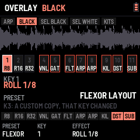

**SEL BLACK** (0.9.49, EXPERT, the third tab; SEL KEYS in 0.9.49) gives every black key a **second function, pressed with SEL** held or
locked (SEL twice): **K2 KEY** (or **ALGORITHM**, or press the key: it picks itself), **K3 SEL +**, what that key does
with SEL: **ITS OWN** (the same as without SEL, exactly: 0.9.56, FLEXOR; SEL + R8 / R16 / R32 rolled the kick alone until 0.9.55) or any
function of the list. While SEL is held or locked the strip and the lights show the SEL functions. A key pressed with
SEL keeps that function until you let it go. SAVE keeps them; RESET's SEL KEYS and RESET ALL clear them. The **REC**
key, last on the right, has one too (0.9.70, FLEXOR; press REC on this tab to pick it): any function but ARP; SEL + REC
plays it, REC alone does what BLACK gives it (NONE: it records).

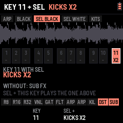

**LIGHTS** (0.9.57, FLEXOR; after SCREEN SET): the FM-1's lights. They have four levels, each with a meaning: **off**,
the **glow** (at rest: there, it does something), **mid** (assigned, or where the sequencer is) and **lit** (on,
playing). Every button and key glows at rest (the keys too, since 0.9.57); a lit one is lit; on a lane's page (SEQ, a
drum lane) the step playing is at mid (it was the step's light turned over); while SEL is held or locked the black keys
with a SEL BLACK function and the buttons with a SEL combination (EDIT, SEQ,
ENV, ARP, REC, SAVE) are at mid. The page shows the FM-1's lights as they are now, the buttons, the black keys and the
white keys, live.
- **K1 GLOW**: how bright the lights at rest are: **OFF** (only the lit and mid ones), **1** to **7** (6, as the
  buttons glowed before, to start). The lit lights are always at full: the FM-1 has no other strength for them.
- **K2 PULSE**: the lights at rest raised on the tempo while PLAY runs: **OFF** (to start), on each **KICK**, every
  **1/8**, **1/4** (a beat), **1/2** or **BAR**. Stopped, nothing pulses; the build and the drop keep their own lights.
- **K3 PULSE ON**: which: the **BUTTONS**, the **WHITE KEYS**, the **BLACK KEYS**, **ALL KEYS** (to start) or
  **EVERYTHING**.
- **K4 STYLE**: **FLASH** (lit a moment), **FADE** (lit, then mid, then back to rest), **BREATHE** (up through mid to lit
  and down again), **BLINK** (lit half the time), **CHASE** (one light running along them, a step a pulse, the one
  before it at mid).

A lit light (a step on, a pad on) stays lit through the pulse. SAVE keeps them; RESET's SCREEN puts them back as they
came.

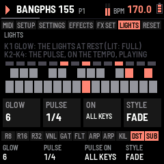

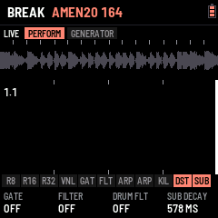 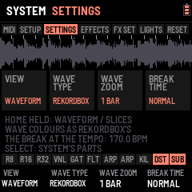

**RESET** (SYSTEM's last part): puts one part back as it starts, the rest kept. **K4** picks what, in a list that scrolls (ALGORITHM goes to SYSTEM's other parts, as on its other pages; each says
on the right what it puts back): DROP, BUILD, KNOB; **KICK** (the kick selected, KICK 1–20: ROTTERDAM again, its
SYNTH, BASS, CLEAN SUB and MORPH at 0, its volume kept, its memory with it); **KICK TONE** (its EQ flat, its two FX slots empty);
**ALL KICKS** (KICK 1–20 as they came: the eleven built-in kicks, KICK 1 909, KICK 2 909 DRIVE, KICK 3 TECHNO, KICK 4 ROTTERDAM (the start), KICK 5 EARLY HC, KICK 6 INDUSTRIAL, KICK 7 TERROR, KICK 8 SPINE, KICK 9 GABBER, KICK 10 MILLENNIUM, KICK 11 DOOMCORE, then round again; their knobs as they start); **DRUMS** (the snare's, hat's and clap's memory playing as it
came); **MIX** (the MIXER: levels, swing, the drums' route, COMP and DUCK off with their timing, MAX OUT −3 dB);
**FX CHAIN** (the four slots as they came, each effect's memory forgotten, the FX level kept); **STEPS** (this
pattern's drum steps: 1 hit, ALWAYS, on time; the steps themselves kept); **BLACK KEYS** (their settings: rolls,
THRU, filter, gate, VINYL, the LATCHES, KIL's and X2's too; the layout kept); **ARP** (0.9.52: the sixteen effects'
AMOUNT, each one's THRU, RATE, SWEEP, LATCH off, every ARP key one effect); **WHITE KEYS** (each, on every break: one slice, pitch 0,
LOOP, no DECAY, its slice effect off); **WHITE LENGTH** (0.9.71: the break playing's white keys one slice each again, their
PITCH, MODE and DECAY kept, the other breaks' keys untouched); **SPLITS** (0.9.73: every break's split OFF, its break B and bars kept); **SEL KEYS** (0.9.52: SEL + a black key or REC its own again);
**TRACK** (this track: from its first item, every item's break SAME; its items kept); **SCREEN** (the skin RED, the
screen effects off, their settings at 50 %, WAVE ZOOM one bar; the LIGHTS as they came, 0.9.57); **WIPE MEMORY** (before installing another firmware: every save LOAF BREAKER keeps in the FM-1's memory erased, a sector at a time while the screen counts to 40, playing stopped first; then MEMORY WIPED, and nothing is saved again until the FM-1 restarts: install the other firmware next, and it finds that memory blank); and last **EVERYTHING**: RESET ALL, everything back
to how it came (tempo, generator, FX chain, the drums, mixer, keys, slices, SYSTEM, the tracks and all 64 patterns; the
first break, saved at once; the screen says so: LOBOTOMIZED, for 3 seconds). To reset it, **turn K2 five clicks**, each
within 2 s of the last (five boxes fill as you turn; a pause starts them again from 0), then **press GLO** within 5
seconds to confirm (the page says PRESS GLO TO RESET; not pressed, or the page left: nothing is reset). Once done, the page shows **DONE (WAIT 3 S)** and **every knob there does nothing for 3 seconds**: the clicks
you turn past the last one are lost instead of starting a new count, and DONE stays to read.

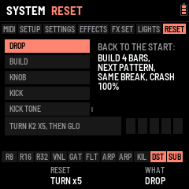

## 8. The drums: kick, snare, hat

Three synthesised drums play under the break, in time with it (swing included), on the pattern's drum lanes (§5):
their steps are SEQ's KICK, SNARE and HAT lanes; their sounds are made on **EDIT**. They go around the FX chain
(AROUND, the default on a new FM-1 and after a reset, whatever the mode: 0.9.2), or through it together when MIX ›
ROUTING K2 says THRU; saved, THRU stays THRU at the next start.

**EDIT** opens SOUNDS' KICK (SELECT: its next section; EDIT again, EXPERT: the next sound, KICK SNARE HAT CLAP round, 0.266); **SEL + EDIT** the next source: DRUMS (SNARE, HAT, CLAP: **EDIT again** the next), BREAK, the KICK again (the tabs show which).
**ALGORITHM** turns through the drum's parts, **PRESETS** loads a built-in sound. The lower strip shows the three
drums side by side, each with its waveform (one hit, drawn again as you change the sound), the one edited outlined,
lit on its hits. The white keys keep playing slices.

### The kick

A synthesised kick for gabber, hardcore and techno. ALGORITHM turns through its parts: MIX → SUB → SUB FX → PUNCH →
PUNCH FX → GRIT → GRIT FX → CLICK → CLICK FX → MACRO → OUT (each layer's part is its LAYER knobs, its FX part its
LAYER FX knobs).

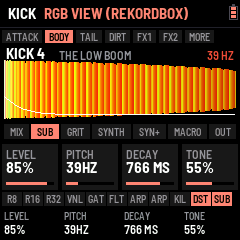 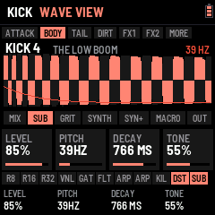 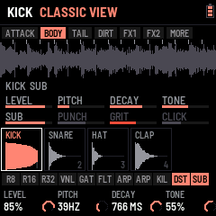 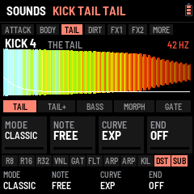 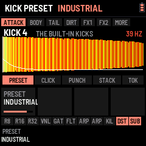

The kick is four layers summed and pushed into a clipper:

| Layer | Is | PITCH | DECAY |
| --- | --- | --- | --- |
| SUB | The low end: a sine dropping onto its pitch (TONE saturates it) | 30 – 90 Hz | 60 – 1500 ms |
| PUNCH | The hit and the body: a sine swept down fast (TONE: how far it sweeps) | 50 – 200 Hz | 20 – 400 ms |
| GRIT | The dirty mids: FM through a drive (TONE: more FM and noise) | 40 – 400 Hz | 20 – 800 ms |
| CLICK | The attack: a click and noise (TONE: from click to noise) | 1 – 12 kHz | 1 – 40 ms |

| Control | Does |
| --- | --- |
| ALGORITHM | The part: MIX, a layer (SUB, PUNCH, GRIT, CLICK), its FX, MACRO, OUT |
| PRESETS | The kick selected: KICK 1–20, each its own memory |
| OUT K4 PRESET | A built-in kick on the kick selected (0.9.39, FLEXOR's choice by ear): 909 (round: a pure sine at 52 Hz, the SUB 614 ms), 909 DRIVE (the 909 driven 75 %, DISTO TUBE 15), TECHNO (39 Hz, the RUMBLE), EARLY HC (more body: the SUB saturated, ASYM, DISTO HALF 25), ROTTERDAM (the start), INDUSTRIAL (darker: GRIT through RING MOD, DISTO TUBE 25), TERROR (FLEXOR's: ROTTERDAM with DISTO 30 % FOLD, DRIVE 69 %, no GRIT, the SUB to 1279 ms through DRIVE 50 %, TAIL MODE CLEAN, TAIL + DRIVE 100 %, EQ LOW +5 dB, DROP +20 in 167 ms, a pure sine), SPINE (TERROR with DRIVE 50 %, D+ TYPE RECT, the SUB to 766 ms, TAIL MODE CLASSIC), GABBER (DRIVE 95 %, DISTO FOLD 25, TAIL + DRIVE 70), MILLENNIUM (a long tuned tail: NOTE set, the SUB 1100 ms, TAIL + DRIVE 85), DOOMCORE (34 Hz, the SUB 1360 ms, DISTO TUBE 20, the RUMBLE). All but ROTTERDAM have TAIL MODE CLEAN (SPINE CLASSIC) and set their own SYNTH and LAB, and the KICK EQ flat but TERROR's and SPINE's LOW, +5 dB (0.9.47, FLEXOR: no built-in kick's EQ above +5 dB); ROTTERDAM leaves the EQ as it was. DISTORTO is gone (a kick saved from it keeps its sound and its name). The steps, routing and volume stay |
| MIDI note 36 (C1) | Plays the kick, from any channel, also while stopped |

| Part | K1 | K2 | K3 | K4 |
| --- | --- | --- | --- | --- |
| MIX | SUB level | PUNCH level | GRIT level | CLICK level |
| SUB · PUNCH · GRIT · CLICK | Level | Pitch | Decay | Tone |
| … FX | Effect: OFF · DRIVE · CRUNCH · FILTER · RING MOD | A (gain · bits · cutoff · frequency) | B (tone · rate · resonance) | Wet |
| MACRO | SUB (level, tail, weight) | PUNCH (level, sweep, click) | GRIT (level, dirt, tail) | INTENSITY |
| OUT | Volume | DISTO | SCREAM | PRESET (a built-in kick) |

**INTENSITY** is the drive into the clipper: low is a clean, round kick; past half the clip turns hard, the tail
flattens into the long, distorted gabber kick.

#### The KICK LAB (TAIL, TAIL +, STACK, TOOLS)

The KICK LAB is where a hardcore kick is built the way it is in a studio: its tail tuned and shaped, its attack
taken from another kick. Its pages sit where they act: **TAIL** and **TAIL +** in the TAIL section, **STACK** in
ATTACK, **TOOLS** in MORE. Everything in it is the kick's own (each KICK 1–20 its LAB), saved with SAVE; a kick with
nothing set there sounds exactly as it always did.

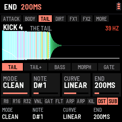 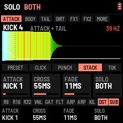

| Part | K1 | K2 | K3 | K4 |
| --- | --- | --- | --- | --- |
| TAIL | MODE: CLASSIC · CLEAN · SPLIT · DIRTY (0.9.71) | NOTE: FREE · A#0 … A2 | CURVE: EXP · LINEAR · SNAP | END: OFF · 40 – 1000 ms by 20 ms, then on to 3000 ms by 50 ms (0.9.70) |
| TAIL + | FILTER: OFF · 11 kHz – 190 Hz | F TIME: 20 – 600 ms | DRIVE: OFF · 1 – 100 % | SPLIT AT: 30 – 600 ms (SPLIT) · DIRT RISE: 50 – 2000 ms (DIRTY); empty in CLASSIC and CLEAN |
| STACK | ATTACK: OFF · KICK 1–20 | CROSS: 10 – 300 ms | FADE: 2 – 150 ms | SOLO: BOTH · ATTACK · TAIL |
| TOOLS | MUTATE | A/B | | |
| TOK (ATTACK) | LEVEL: OFF · 2 – 100 % | TYPE: SQUARE · NOISE · SINE | PITCH: 400 Hz – 4 kHz | LENGTH: 2 – 30 ms |
| GATE (TAIL) | DIVISION: OFF · 1/8 · 1/12 · 1/16 · 1/24 · 1/32 | LENGTH: 10 – 90 % | FADE IN: OFF · 20 – 1000 ms | |

- **TOK** (0.9.45, picked by ear) is a short, pitched attack in front of the kick: a SQUARE (the dry, hard tok), a burst
  of NOISE in a band, or a rounder SINE, falling from its PITCH to a third of it in a few milliseconds, LENGTH long. It
  goes into the clip with the layers, so DISTO and DRIVE take it too. Turned on the first time it starts at about
  1.4 kHz and 15 ms.
- **GATE** chops the kick in time from its second 16th on: at 1/16 it rolls in sixteenths, at 1/32 it stutters, at
  1/12 it rolls in triplets; LENGTH is the part of each chop that sounds (short: dry and choppy), FADE IN lets the chop
  come in little by little. It follows the tempo, and the next kick cuts it as it cuts the tail.

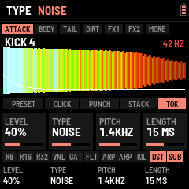 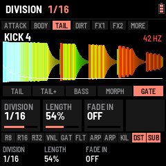

- **MODE CLEAN** fixes the "goofy" tail. In CLASSIC the kick fades *before* its distortion, so DISTO's fold and SCREAM
  change colour as it falls (the tail "talks": wah, yoy), and PUNCH and GRIT sit on notes of their own that rub
  against the SUB's. In CLEAN the distortion works on a steady sound and the fade comes after it, at the same
  loudness; PUNCH and GRIT land on the SUB's octave, GRIT's FM is harmonic, and the RUMBLE's echo is tuned to the
  note. The kick stays one note from the hit to the end.
- **MODE SPLIT** (0.9.71, FLEXOR): the body as CLASSIC, all its dirt, then at **SPLIT AT** (TAIL + K4, 30 – 600 ms;
  the tail turns clean over half that time again) the kick fades into a clean sine on the SUB's note, as loud as the
  kick was there, falling as the SUB does: the dirty hit and a round, long sub after it, without the ringing of a
  distorted held note. **MODE DIRTY**: the inverse, the hit driven at a third of its DRIVE (tight), the drive and
  DISTO rising to three times over **DIRT RISE** (TAIL + K4, 50 – 2000 ms): the tail dirtier as it falls. Picking
  either puts its TAIL + K4 half way (SPLIT 133 ms, DIRTY 316 ms).
- **NOTE** puts the tail on a note (the SUB's PITCH otherwise, FREE), shown in Hz at the top right: tune it to the
  track's key. **CURVE** shapes the pitch drop: EXP as always (fast, then a long slide), LINEAR and SNAP (high, then
  down fast) land exactly on the note at half the drop's TIME and stay there: no slide left in the tail.
- **END** cuts the kick (in 5 ms) at that length, white dashes on the picture: a tight tail at 200 BPM. From 40 ms to 1 s by 20 ms, then on to 3 s by 50 ms for the longest tails (0.9.70, FLEXOR).
- **FILTER** closes a low-pass on the kick as it goes, from open at the hit down to its value in **F TIME**: the
  attack bright, the tail darker, the fizz gone. **DRIVE** pushes the tail (after the attack) harder into the clip:
  a denser, flatter tail.
- **STACK** is layering: **ATTACK** takes the hit from another kick (KICK 1–20, as it is in its memory, its own LAB
  too), this kick plays the tail. **CROSS** is where one hands over to the other (amber dashes on the picture),
  **FADE** how long the hand-over takes. **SOLO** lets you hear the attack alone or the tail alone (not saved).
  Two kicks sound at once until the hand-over: watch the METER (SYSTEM › MIDI K3) with STACK on.
- **MUTATE** (K1 right) moves the kick's layers and INTENSITY a little at random, each detent again; K1 left goes
  back to before the first. **A/B** (K2) swaps the kick you are editing (A) with itself as it came or was last saved
  (B); edit either, SAVE keeps the one playing.

OUT K4 PRESET (a built-in kick) turns the LAB off on that kick; COPY K n and SEL + ARP (copy, then paste on another kick) copy its LAB too; RESET KICK and ALL KICKS
turn it off. BEGINNER shows TAIL and STACK. The page is laid out as the snare's and the hat's: the part's four
settings as bars, under them the four layers' levels (the layer edited lit, amber with an effect on); the kick's
shape is its box in the strip below. Its steps: SEQ's KICK lane (empty to start).

### The snare and the hat

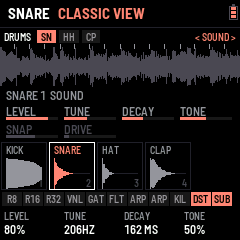

**EDIT** again from the kick: the snare, then the hat. **ALGORITHM** turns between its SOUND and SHAPE knobs,
**PRESETS** picks a built-in sound. Their steps: SEQ's SNARE and HAT lanes.

| Voice | Is | Presets |
| --- | --- | --- |
| SNARE | Two tuned sines with a pitch drop (the body) and band-passed noise (the snares), with a crack on the hit | 909 · TIGHT · FAT · GABBER, then FLEXOR's industrial ones: SHRAPNEL · GRINDER · PISTON · CONCRETE · BUNKER · SHRAP CRUSH · GRIND CRUSH · CONCR SMASH · GABBER BITS |
| HAT | Six square waves at the 808's ratios and noise, through two high-passes | CLOSED · 808 · OPEN · TRASH |
| CLAP | Noise bursts and a tail | 808 · 909 · TIGHT · BIG · BUNKER CLAP · FURNACE CLAP |

| Knobs | K1 | K2 | K3 | K4 |
| --- | --- | --- | --- | --- |
| SOUND | Level | Tune | Decay | Tone (the hat: METAL / NOISE) |
| SHAPE | Snap (the hat: CUT, the high-pass; the clap: SPREAD) | Drive | PRESET | **DIRT**: SOFT (as ever), HARD (a hard clip), FOLD (folded back, as the kick's DISTO), BITS (5 bits) |
| SPACE | **DROP** (the snare: how far its body falls, x1.7 to x6) | **TIME** (how fast it falls, 3 to 140 ms) | **LIFT** (the tail brought up, the hit held down) | **ROOM** (a short room closed sharply after the hit: its level and its length) |
| BEGINNER | **PRESET** | **FX**: DRY · ROOM · CRUSH · SMASH (twice the drive, the tail lifted, a longer room) · SMASH+BITS | Level | Tune |

**ALGORITHM** goes through SOUND, SHAPE and SPACE (MORE until 0.9.67). FLEXOR's snares came out of three listening pages (gabber,
crossbreed, industrial: the drop, the dirt, the lift and the room); each comes with the FX it was chosen with, and in
BEGINNER the FX changes on the same preset (its LEVEL and TUNE kept). Each memory (SNARE 1-10 ..) keeps its own.

MIDI notes 38 (D1) play the snare, 42, 44 and 46 the hat, also while stopped. SAVE keeps the drums with the rest.

### Your own snare, hat and clap (IMPORT)

Each drum can play a sample of yours in place of its synthesis (0.9.45). The site's
[Import](https://flexor-r.github.io/loaf-breaker/import/) page, in Chrome or Edge on a computer, puts them on the FM-1:

1. **Connect** (LOAF BREAKER stopped): the page reads the samples already on the FM-1, so you can change one and keep
   the others.
2. **Drop a sample on the SNARE, the HAT or the CLAP** (any format the browser plays). The silence before the hit and
   its quiet end are cut, a second at most is kept, its peak brought to −0.3 dBFS. **Play** (or click its wave) hears it
   as the FM-1 will play it; **Length** shortens it; **Name** is what the FM-1 shows.
3. The FM-1 keeps **8 KB** for the three, compressed as the breaks: the page plays them at the highest rate that fits,
   22.05 kHz (about 0.7 s for the three together), 16 kHz (about 1 s), then 11.025 kHz (about 1.4 s), and shortens
   them only past that. The meter says the room and the rate.
4. **Send to the FM-1**. **Delete them from the FM-1** gives every drum its synthesis back.

On the FM-1, each drum's **PRESET** (EXPERT: SHAPE's K3; BEGINNER: K1) has one more, the last: your sample, under its
name (the picture on EDIT draws it). On a sample, **TUNE** repitches it (±12 semitones, 0 as recorded), **DECAY** fades it
(FULL: as recorded, then 30 ms to 1.5 s), **TONE** darkens it to the left (a low-pass, 18 kHz to 400 Hz) or thins it to
the right (a high-pass, 20 Hz to 3 kHz), OPEN in the middle; **DRIVE**, **DIRT**, **LIFT**, **ROOM** and BEGINNER's
**FX** work as on the synthesised drums (SNAP, CUT, SPREAD, DROP and TIME are the synthesis's: "-"). Each drum memory
keeps its choice (SAVE); another PRESET gives the synthesised drum back. The samples stay through RESET ALL; WIPE
MEMORY erases them.
(ENV, which used to open SNARE / HAT, is TRACK now: §3.)

## 9. The mixer

**LFO** opens the MIXER: three channels side by side, each a fader (BREAK, KICK and PERC with a level meter).
**SELECT** turns to ROUTING, MASTER and DYNAMICS (0.9.2; **LFO again** goes back to HOME): ROUTING (the FX fader, the chain's four slots beside it, lit: on; DRUMS, their route; DUCKS, what DUCK pushes down under each kick: BREAK, PERC or BOTH, 0.9.64; ROLL, what the three roll keys roll: BREAK, KICK (the kick hit at the roll's rate instead of its pattern; the break plays on) or BOTH, 0.9.40). **LFO held +
K1–K4**, on any page: the break's, the kick's and the drums' level, and (K4, 0.9.50, FLEXOR) the FX fader, 5 % a detent (the MIXER's own page: 2 %), the page staying where it is (LFO let go after a turn opens nothing): the mix moved without
going into the MIXER.

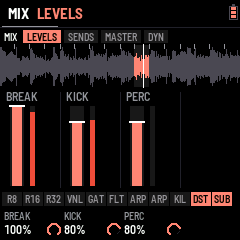 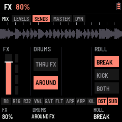 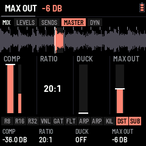

| Half | K1 | K2 | K3 | K4 |
| --- | --- | --- | --- | --- |
| LEVELS | BREAK: the break's level (its throws into the delay and the reverb too) | KICK: the kick's level (the KICK page's VOLUME) | PERC: the snare, the hat and the clap together | |
| ROUTING | FX: the master FX chain against the dry sound | DRUMS: through the FX chain or around it | DUCKS (0.9.64): what MASTER's DUCK pushes down at each kick: BREAK (the break and its echoes), PERC (the snare, hats and clap alone: the kick in front of the snare, the break untouched), BOTH. The same as DYNAMICS' K4 | ROLL: what R8 · R16 · R32 roll, BREAK, KICK or BOTH (0.9.40; their K2 before) |

FX is how much of the chain you hear (the drums routed around it stay dry). Bring BREAK down to drop the break and
let the drums run alone, then up again for the drop. HOME keeps the gate (K1), the drums' filter (K3) and the SUB's decay (K4) to ride, and the **DJ filter** (K2), which
filters the break alone: sweep it down and the drums stay full on top.

## 10. Pages and knobs

| Page | K1 | K2 | K3 | K4 |
| --- | --- | --- | --- | --- |
| HOME (perform) | Gate | Filter: the DJ filter on the break (left low-pass, right high-pass) | Drum flt: the same on the drums | Sub decay: the kick's SUB's length |
| HOME again (generator) | Complexity | Anchor | Roll | Fill |
| EDIT, the KICK menu (SELECT: its section; ALGORITHM: its part; EDIT again: the next sound) | ATTACK: PRESET, CLICK, PUNCH, STACK, TOK · BODY: MIX, SUB, GRIT, SYNTH, SYNTH +, MACRO, OUT · TAIL: TAIL, TAIL +, BASS, CLEAN MORPH, GATE · DIRT: DISTO, DISTO +, SCREAM, the layers' effects · FX1, FX2 · MORE: KNOBS, ASSIGN, K1–K4 SET, TOOLS, EQ B, EQ S (§8) | | | |
| The drums (SELECT on the big view; SEL + EDIT; EDIT held: the other view) | Level · Snap / cut / spread / bend | Tune · Drive | Decay · Preset | Tone |
| SEQ (the break's steps) | Slice | Pitch | Hits | Reverse |
| SEQ, a drum lane | Fill | Sound: the kick (KICK 1–20), the drum's memory | Clear / 4x4 / grooves | Length |
| SEQ, a drum step held | Note (the kick's) | Hits | Cond | Nudge |
| ENV TRACKS (ALGORITHM: the item; PRESETS: the track; a white key: its pattern in; SEL + PLAY: start here) | Kick (a DROP: its build's) | Pattern / DROP / END | Loops (a DROP: stutter) | Its break (a DROP: gap keeps) |
| ENV PLAY (PLAY: the track) | Track | From item | At the end | |
| ENV DROP | Build bars | After the drop | Break | Crash |
| ENV BUILD (PRESETS: tempo rise) | Style | Sweep | Riser | Gap |
| ENV BUILD BRK | Break: still / roll | Roll from | Gap keeps | |
| ENV DROP BANK (white keys 1–8: the drop) | Drop | Build | Style | After |
| EDIT KICK › KNOBS, K1 SET .. K4 SET (ALGORITHM: the knob; PRESETS: its function) | its function's four settings | | | |
| LFO (mixer: levels; LFO held, any page: the same) | Break level | Kick level | Drums level | LFO held: the FX fader (ROUTING's FX, 0.9.50; the FX page shows it as FX MIX nn %) |
| LFO, ROUTING (SELECT) | FX (the chain, dry to wet) | Drums: through the chain or around it | Ducks: BREAK, PERC or BOTH | ROLL: break, kick or both |
| LFO, MASTER | Comp | Ratio | Duck | Max out |
| LFO, DYNAMICS | Comp attack | Comp release | Duck release | Ducks: BREAK, PERC (the drums alone) or BOTH |
| FX (the chain; SELECT the slot, ALGORITHM its part) | the focused slot's effect: its three settings (ALGORITHM: its MORE and MOD parts; an MB COMP its six, see §6) | | | Its mix |
| GLO (MIDI) | Clock in | Clock out | Meter (EXPERT) | |
| SOUNDS › BREAK (SEL + EDIT; ALGORITHM: the break) | Pitch: keep length / speed | Grain | Snap | Level |
| GLO, SETUP (SELECT) | Skin | Kick EQ (EXPERT) | Mode: tutorial / beginner / expert | Auto save |
| GLO, DISPLAY (SELECT twice) | View: waveform / slices | Wave type | Wave zoom | Break time |
| GLO, SCREEN FX (SELECT three times; keys 1–7: each on or off) | The effect | On / off | Drum filter | Kick switch |
| GLO, SCREEN SET (SELECT four times) | Amount | On a kick | At the drop | Length |
| GLO, LIGHTS (SELECT five times) | Glow | Pulse | Pulse on | Style |
| GLO, RESET (SELECT six times; ALGORITHM: what too; after a reset, 3 s at rest) | What | Reset (five clicks) | Reset (five clicks) | Reset (five clicks) |
| ARP | Amount (the effect touched last) | Thru | Rate / Sweep | Latch |

**Gate** (HOME K1) cuts every slice the loop plays short: at 50 % each slice sounds for half its length, then
quiet until the next; down to 5 % for clipped, staccato chops; 100 % is off. It follows the tempo and the pitch, and
the slice lit in the waveform shrinks with it. It covers the loop's slices, ratchets and the RANDOM pad; key loops
(their LENGTH) and rolls keep their own.

The generator rearranges the break as it plays: **complexity** is how often it jumps, **anchor** keeps the kick and
snare on the beats, **roll** repeats a slice or takes the one next to it, **fill** breaks the rules in the last bar
of a phrase; it is HOME's second part (HOME again). (ARP is the effects' page; SEL + ARP PATTERN › GROOVE.)

## 11. The control map

Every page, button, encoder and key in one place. On the site's manual
this section is interactive: pick a page and the screen, the seven encoders and the keys show what they do there;
below it, each button with its parts, the whole map as one table, and which of a held key, a held pad or the page
owns K1–K4. Here, in short: §2 has the rules, §10 every page's knobs.

## 12. Saving

SAVE keeps the tempo, pitch, swing, generator, the FX chain, the break chosen, each key's loop, the drums, the
mixer, the SYSTEM settings and the patterns (the group of 16 in memory: the others were saved when you left them); SAVE is lit when something changed. A new version keeps what an older
one saved: new settings start at their defaults. (Version 0.32 changed the layout: what 0.31 and older saved starts
over at the defaults once.) SYSTEM › RESET › EVERYTHING clears it all on purpose (§7).

## 13. Troubleshooting

- **No sound:** turn MASTER up; press PLAY.
- **A crash screen:** press a key to restart. Two failed starts in a row start safe mode, which the installer can
  still reach.
- **The install stops:** press Install again; it finishes a write that was cut off.
