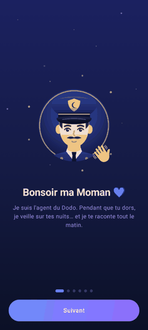

# Police du Dodo 👮💤 : suivi du sommeil pour Android




Police du Dodo écoute la nuit et **n'enregistre que les sons qui se détachent du bruit de fond** : paroles, cris (terreurs nocturnes), ronflements, rires, pleurs, toux. Chaque son est reconnu automatiquement et peut être réécouté le matin, avec une version « voix isolée » pour mieux comprendre ce qui a été dit.

Tout est traité **sur le téléphone**. Aucun son n'est envoyé sur Internet.

## Interface
- **Tuto au premier lancement** : un diaporama animé de 6 pages (« Bonsoir ma Moman », j'écoute la nuit, je reconnais les sons, voix isolée, comment ça marche, réveil). On peut le revoir depuis Réglages > Aide.
- **Logo animé** : le policier a les yeux ouverts et cligne avant la nuit. Il s'endort avec des « Zzz » pendant la surveillance, puis ouvre les yeux quand le réveil sonne. Le dessin vient d'une seule source, `tools/logo.py`, qui génère l'icône et le code.
- **Ce soir** : un gros bouton « Commencer », le rapport du soir (caféine, sport, écrans…) et le score de la dernière nuit.
- **Pendant la nuit** : un orbe qui réagit au son, le temps écoulé et le nombre de sons relevés par type. Le bouton « Je me réveille » arrête la surveillance.
- **Mes nuits** : un rapport par nuit avec le score, les chiffres clés, les phases et la liste des sons à réécouter (original ou voix isolée).
- **Tendances** : graphiques sur 7, 30 ou 90 jours et « l'enquête » sur ce qui influence vos nuits.
- **Réglages** : 3 modes (Discret, Normal, Tout capter) suffisent en général. Le réglage fin par type de son est rangé dans une section repliable.

## Fonctionnalités

### Écoute et enregistrement intelligents
- **Suivi du bruit de fond** : le niveau ambiant (ventilateur, frigo, rue…) est réestimé en continu, c'est le 20ᵉ percentile des 60 dernières secondes. Un son n'est retenu que s'il dépasse ce fond d'un certain nombre de dB.
- **Sensibilité du micro réglable (1 à 10)** : de +21 dB au-dessus du fond (seuls les sons forts) à +4 dB (chuchotements).
- **Pré-enregistrement de 1,5 s** : le premier mot n'est pas coupé. L'enregistrement s'arrête après 2 s de calme et ne dépasse pas 60 s par fichier. Les clics de moins de 0,4 s sont ignorés.
- Micro en mode `VOICE_RECOGNITION` : flux brut, sans le filtre anti-bruit du téléphone qui effacerait les ronflements.

### Reconnaissance des sons
- Le modèle **YAMNet** (Google, AudioSet, 521 classes) tourne sur le téléphone avec MediaPipe. Ses classes sont regroupées en catégories :

| Catégorie | Classes YAMNet |
|---|---|
| 🗣️ Paroles | Speech, Conversation, Whispering, Babbling… |
| 😱 Cris / terreur nocturne | Screaming, Shout, Yell… |
| 😴 Ronflement | Snoring, Snort |
| 😂 Rire | Laughter, Giggle, Chuckle, Belly laugh… |
| 😢 Pleurs | Crying/sobbing, Baby cry, Whimper, Wail… |
| 🤧 Toux | Cough, Sneeze, Throat clearing |
| 💨 Respiration bruyante | Breathing, Gasp, Wheeze, Groan… |

- **Intensité de captation par catégorie (1 à 10)** : elle fixe le score minimal demandé au modèle. Au niveau 10, un rire étouffé ou de légers sanglots sont retenus. Au niveau 1, seuls les cas évidents le sont.
- Si deux catégories ont des scores proches, l'ordre de priorité est le suivant : cris, pleurs, rires, puis paroles.
- Si le modèle ne se charge pas, un classifieur acoustique simple prend le relais. Il s'appuie sur la hauteur de la voix, les basses fréquences et le rythme des syllabes.

### Isoler la voix du bruit ambiant
Pour les paroles, cris, rires et pleurs, l'application crée une deuxième version du fichier :
1. Elle mesure le spectre du bruit juste **avant** l'événement.
2. Elle soustrait ce bruit fréquence par fréquence (soustraction spectrale avec lissage).
3. Elle garde surtout la bande de la voix (90 Hz – 5 kHz).
4. Elle normalise le volume pour rendre audibles les chuchotements.

### Autres outils de suivi
- **Phases de sommeil estimées** (éveil / léger / profond) par actigraphie. Il faut poser le téléphone sur le matelas : l'accéléromètre capte les mouvements et les sons complètent la mesure. On obtient un hypnogramme et l'heure d'endormissement et de réveil.
- **Score de sommeil sur 100**, calculé à partir de la durée, de l'efficacité, de la part de sommeil profond, des réveils et des ronflements.
- **Réveil intelligent** : il sonne pendant une phase de sommeil léger, dans une fenêtre de 0 à 45 min avant l'heure limite. Il passe par-dessus l'écran verrouillé et propose un snooze de 9 min.
- **Rappel du coucher** chaque soir.
- **Journal** : étiquettes du soir (caféine, alcool, sport, stress, écrans…), humeur au réveil, notes et rêves.
- **Tendances sur 7, 30 ou 90 jours** : durée, score, sommeil profond, ronflement, régularité des horaires. On y voit aussi l'effet de chaque étiquette du journal sur le score.
- **Conseils** selon la nuit : nuit courte, ronflements fréquents (avec une mention de l'apnée du sommeil), chambre bruyante…
- **Gestion des fichiers** : suppression automatique après N jours, sauf pour les favoris ❤. Les sons peuvent être partagés et toutes les données exportées en CSV.
- Option de **délai avant détection**, pour laisser le temps de s'endormir.

## Installer sur un téléphone Android
1. Sur le téléphone, ouvrir l'APK (`police-du-dodo-debug.apk`) reçu par mail, Drive ou WhatsApp, ou téléchargé.
2. Android demande d'autoriser l'installation depuis cette application (Chrome, Fichiers, Gmail…) : **Paramètres > Autoriser cette source**, puis revenir en arrière.
3. Appuyer sur **Installer**. Si Play Protect prévient que l'appli est inconnue : **Plus de détails > Installer quand même**.
4. Ouvrir **Police du Dodo**, suivre le tuto, puis accepter le **micro** et les **notifications**.
5. Conseillé : **Paramètres > Applis > Police du Dodo > Batterie > Non restreinte**, pour que l'écoute ne soit pas coupée la nuit.

## Compiler

Il faut le JDK 17 ou plus récent et le SDK Android 35.

```bash
cd sleep-app
./gradlew assembleDebug
```

Le modèle YAMNet (4 Mo, licence Apache 2.0) est téléchargé automatiquement au premier build. L'APK est ensuite dans `app/build/outputs/apk/debug/app-debug.apk`.

Pour lancer les tests unitaires (détecteur, isolation de la voix, classification, analyse du sommeil, captures d'écran) :

```bash
./gradlew testDebugUnitTest
```

Pour régénérer les captures d'écran dans `app/src/test/snapshots/` :

```bash
./gradlew recordPaparazziDebug
```

## Conseils d'utilisation
- Branchez le téléphone : l'écoute dure toute la nuit.
- Excluez Police du Dodo de l'optimisation de la batterie, sinon certains fabricants coupent le service.
- Posez le téléphone près de la tête, micro vers vous. Mettez-le sur le matelas si vous voulez mesurer les mouvements.
- Pour un enfant (pleurs, terreurs nocturnes), posez le téléphone dans sa chambre et montez la sensibilité des catégories Pleurs et Cris.

## Limites
- Les phases de sommeil et le score sont des **estimations** et non un diagnostic médical. En cas de ronflements forts avec des pauses respiratoires, ou de terreurs nocturnes fréquentes, consultez un médecin.
- L'application ne fait pas de transcription automatique des paroles. Elle enregistre et améliore l'audio pour qu'on puisse l'écouter.
- Écouter les sons d'une autre personne qui dort suppose son accord.

## Structure du code

Le code garde le nom de paquet interne `com.somnia.app`. L'identifiant de l'application installée est `com.policedudodo.app`.

```
app/src/main/java/com/somnia/app/
├── audio/      détection (SoundEventDetector, NoiseFloorTracker), YAMNet,
│               classifieur de secours, isolation de la voix, WAV, FFT
├── service/    SleepTrackingService : micro, accéléromètre, réveil intelligent
├── analysis/   phases et score (SleepAnalyzer), journal et conseils (Insights)
├── alarm/      réveil, rappel du coucher, écran de réveil
├── data/       base Room (nuits, sons, minutes) et réglages
└── ui/         écrans Compose (Ce soir, Mes nuits, rapport, Tendances, Réglages),
                thème « nuit » et composants (cartes, orbe, logo du policier)
```

## Crédits
- Police du titre et du gros bouton : **Fredoka** (Google Fonts), licence SIL Open Font License 1.1.
- Modèle de reconnaissance des sons : **YAMNet** (Google), licence Apache 2.0.
- Police du gros bouton : **Quicksand** (Google Fonts), licence SIL Open Font License 1.1.
